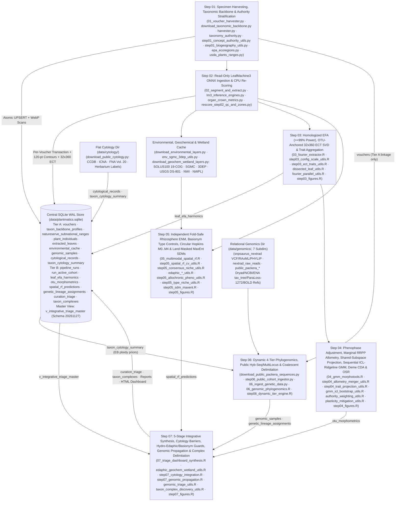

# Plantmatics: Automated Vegetative Phenotyping and Integrative Species Delimitation Pipeline for North American *Packera*

[](LICENSE)
[](https://www.python.org/)
[](https://www.r-project.org/)
[](https://github.com/Gene-Weaver/LeafMachine3)
[](docs/DATA_DICTIONARY.md)

**Principal Investigator:** J. Brandon Fuller (Department of Biology, University of North Carolina at Chapel Hill)
**Faculty Advisor:** Dr. Alan S. Weakley (Director, University of North Carolina Herbarium [NCU])
**Repository:** https://github.com/Plantatsrophe/Plantmatics
**Documentation Suite:** [`docs/TAXONOMIC_SOP.md`](docs/TAXONOMIC_SOP.md) (`UNC-BOT-SOP-2026-04-REV5`) · [`docs/DATA_DICTIONARY.md`](docs/DATA_DICTIONARY.md) · [`docs/ENVIRONMENTAL_DATA_SOURCES.md`](docs/ENVIRONMENTAL_DATA_SOURCES.md) · [`CONTRIBUTING.md`](CONTRIBUTING.md) · [`CHANGELOG.md`](CHANGELOG.md)

## Overview and Scientific Motivation

Species boundaries in North American *Packera* Á. Löve & D. Löve (Asteraceae: Senecioneae) are notoriously difficult to resolve from herbarium labels alone. Across the ***Packera dubia* (Spreng.) Trock & Mabb. complex** and its eastern and continental congeners, individual plants undergo strong developmental heteroblasty from petiolate basal rosette leaves to sessile cauline stem leaves, whereas frequent polyploidy ($2n = 44, 46, 88$; Kowal 1975) and interspecific hybridization blur vegetative boundaries in contact zones. Many taxa also specialize on narrow edaphic islands such as granitic flatrocks and diabase glades, whereas closely related lineages inhabit serpentine barrens or deep coastal plain sands. Because public herbarium aggregators mix specialist determinations with unverified folder labels and split duplicate gatherings (exsiccatae) under conflicting names, naive statistical pooling across raw specimen labels obscures real evolutionary lineages.

I built this seven-stage Python and R pipeline at the University of North Carolina Herbarium (NCU) to test species boundaries across North American *Packera* under the Unified Species Concept (de Queiroz 2007) through Integration by Congruence (Padial et al. 2010). Rather than treating every herbarium folder label as ground truth, I stratify determiners by taxonomic authority and pin verified nomenclatural type specimens as morphological and *locus classicus* ecological baselines. Unverified collections receive zero training weight and project passively into authority-anchored spaces, so label noise cannot distort reference covariances before out-of-sample screening.

At first glance, computer vision segmentation on pressed sheets, fine-grain rhizosphere niche modeling, and nextRAD variant calling look like separate research problems. That separation breaks down in practice because each analytical workflow isolates homologous biological signal from archival noise before testing lineage divergence independently. Step 02 extracts calibrated leaf masks with 31-keypoint anatomical pose skeletons alongside $32 \times 360$ polar Euler Characteristic Transform (ECT) descriptors and optical capitulum phenophases through a read-only [LeafMachine3](https://github.com/Gene-Weaver/LeafMachine3) ONNX adapter. Steps 03 to 07 then evaluate independent morphometric geometry alongside $0\text{ to }15\text{ cm}$ rhizosphere niche and Hopkins flowering models plus standalone phylogenomic dosage and coalescent delimitation before Step 07 combines those streams into reproducible taxonomic revision reports with 300-DPI PNG plates and an offline curatorial triage dashboard.

## Seven-Stage Pipeline Architecture

### Two-Tier Transactional Storage (`data/plantmatics.sqlite`)

All Python and R stages transact against a central SQLite Write-Ahead Logging (WAL) database (`PLANTMATICS_SCHEMA_USER_VERSION = 20261127`, aliased as `PACKERA_SCHEMA_USER_VERSION`; full column-level contracts appear in [`docs/DATA_DICTIONARY.md`](docs/DATA_DICTIONARY.md)) paired with atomic CSV snapshots. Both Python (`scripts/core/db.py`) and R (`scripts/core/db_utils.R`) perform automatic zero-loss atomic rename migration from legacy `data/packera_pipeline.sqlite` (including `-wal` and `-shm` sidecars) on first access, and accept `PLANTMATICS_DB_PATH`, `PLANTMATICS_RUN_DIR`, `PLANTMATICS_GENOMICS_DIR`, `PLANTMATICS_CYTOLOGY_DIR`, plus `PLANTMATICS_TAXONOMY_DIR` overrides alongside `PACKERA_*` fallbacks:

1. **Tier A Shared Canonical Store (`data/`):** Stores invariant Step 01 and Step 02 specimen records (`vouchers` carrying five taxonomic concept clarity fields `typified_basionym`, `verbatim_taxon_concept`, `concept_synonymy_status`, `identification_year`, plus `is_open_or_hybrid_concept`, paired with `taxon_synonyms`) alongside flat `data/taxonomy/` Catalogue of Life WCVP `2232` plus BHL API v3 and NatureServe Explorer backbones (`taxon_backbone_profiles` paired with `natureserve_subnational_ranges`), multi-plant DBSCAN individuals (`plant_individuals`), segmented leaf geometry (`extracted_leaves`), optical reproductive staging (`voucher_reproductive_phenology`), full-sheet WebP scans (`data/raw_vouchers/`), binary masks (`data/masks/`), 120-vertex tip-up contours (`data/contours/`), $32 \times 360$ ECT arrays (`data/ect/`), spatially indexed environmental plus USGS `DS-801` geochemical (`soil_ca_mg_molar_ratio`, `soil_ultramafic_ni_cr_index`, `soil_carbonate_c_pct`) and USFWS NWI wetland (`is_nwi_wetland`, `nwi_wetland_system`, `nwi_wetland_dist_m`) extractions (`environmental_cache` and `environmental_rtree`), flat `data/cytology/` chromosome count and C-value registries (`cytological_records` paired with `taxon_cytology_summary`), plus voucher-linked genetic sample metadata and QC (`genomic_samples`, including `public_plastome_match`, `public_its_match`, and `waxy_lineage_match`).
2. **Tier B Run-Scoped Analysis Store (`runs/<RUN_ID>/` and `runs/latest`):** Registers every run in `pipeline_runs`, snapshots the active specimen cohort in `run_active_cohort`, links shared Tier A imagery without duplicating gigabytes on disk, and isolates all Step 03 to 07 statistical tables (`leaf_efa_harmonics`, `otu_morphometrics`, `spatial_rf_predictions`, `genetic_lineage_assignments` with `public_backbone_clade`, `public_phytop_ils_index`, and `public_phytop_ih_index`, plus `curation_triage` carrying the six cytology columns `cytology_linkage_tier`, `voucher_sporophytic_2n`, `voucher_ploidy_level`, `taxon_reported_cytotypes`, `is_multi_cytotype_taxon`, `cytotype_reproductive_barrier_pass` alongside `hydro_edaphic_niche_regime`, `wetland_fidelity_concordance`, `basionym_synonymy_type`, and `taxon_complexes`) paired with raster suitability surfaces, revision reports, and 300-DPI PNG figures inside `runs/<RUN_ID>/`. The relational view `v_integrative_triage_master` exposes a composite-key join on `(run_id, catalogNumber, plant_individual_id)` across all seven stages while surfacing the five Step 01 concept/basionym columns alongside `backbone_basionym_name`, `protologue_url`, `natureserve_global_rank`, `nwpl_indicator_code`, and `nwpl_wetland_score`.



### Stage-by-Stage Summary

| Step | Primary Entrypoints | Core Inputs | Primary Outputs | Scientific Function |
| :---: | :--- | :--- | :--- | :--- |
| **01** | `scripts/data_prep/01_voucher_harvester.py`<br>`scripts/data_prep/download_taxonomic_backbone.py`<br>`scripts/core/harvester.py`<br>`scripts/core/taxonomy_authority.py`<br>`scripts/core/epa_ecoregions.py`<br>`scripts/core/usda_plants_ranges.py`<br>`scripts/core/coord_hygiene_utils.py`<br>`scripts/core/step01_*.py` | GBIF `StillImage` & iDigBio APIs, CoL WCVP `2232`, BHL API v3, NatureServe Explorer, EPA/CEC Level III Ecoregions, USDA PLANTS county ranges | `vouchers` (with 5 concept/basionym columns), `taxon_synonyms`, `taxon_backbone_profiles`, `natureserve_subnational_ranges`, `curated_vouchers.csv` (23 core columns), `data/raw_vouchers/*.webp`, `data/taxonomy/*.csv` | Dynamic genus-wide (`TaxaConfig.target_genus` / `TaxaConfig.target_family`) or targeted *Packera* harvesting with two-pass country quota pagination, `hasCoordinate=False` cis-Mississippi rescue, unconditional + `country=None` type rescue, indumentum-safe `8 x 8` tile-p90 Laplacian sharpness screening (`check_sharpness: true`), CoL/BHL/NatureServe nomenclature, pre-lumping concept tracking (`typified_basionym`, autonym stripping, open/hybrid passive `Tier_3_Bronze` quarantine excluding named nothospecies such as *Packera ×memmingeri*), core Gold (`L. D. Estes`, Barkley, Trock, etc.) versus regional/historical Silver stratification paired with heterotypic/post-1980 segregate recency caps, ecoregion-bounded transcontinental filtering, `Tier_1_Gold`-first duplicate selection keeping incomplete/centroid singletons unmerged, lossless Tier A ingestion (`spatial_balance_weight = 1.0`), and herbarium-rooftop plus county-centroid coordinate quarantine (`is_centroid_or_inst_coord` paired with `coord_quarantine_reason`) |
| **02** | `scripts/pipeline/02_segment_and_extract.py`<br>`scripts/vision/lm3_inference_engines.py`<br>`scripts/vision/organ_crown_metrics.py`<br>`scripts/vision/capitulum_phenology_classifier.py`<br>`scripts/vision/lm3_compat.py`<br>`scripts/vision/lm3_data_loader.py`<br>`scripts/vision/step02_*.py`<br>`scripts/vision/rescore_step02_qc_and_zones.py`<br>`scripts/vision/step02_figures.py` | `curated_vouchers.csv`, `raw_vouchers/*.webp`, LeafMachine3 ONNX models | `plant_individuals`, `extracted_leaves`, `voucher_reproductive_phenology`, `extracted_leaf_manifest.csv`, `fig02a`, `fig02b`, `lm3_assets/`, `ect_overlays/`, `lm3_sheet_overlays/` | Read-only LeafMachine3 ONNX detection (`yolo26x_det_1280`) paired with UNet++ v9 paper cleanup on the wave coordinator, `RulerClassifierModel`-gated archival ruler versus `tick_lattice_unboxed` calibration, 100% uncut `yolo26x_seg_1024` leaf/petiole/hole masks preserving interior pinnae alongside read-only void QC and analytical `32 x 360` ECT overlays, 31-keypoint pose with 180-degree obovate polarity reconciliation plus native angle/curvature/trace and *Packera* base/margin/lobe traits, wool-preserving 7-key CIELAB photometry paired with within-rosette abaxial leaf quarantine, 2D root-anchored DBSCAN ramet partitioning alongside direct petiole lengths and shape-decoupled `leaf_zone` (with read-only `bbox_x1..bbox_y2` CPU photometry rescoring), plus lateral-only involucre metrics paired with `corymb_head_count_est` and `radiate_head_fraction` optical phenology (gated by `save_debug_crops`) |
| **03** | `scripts/morphometrics/03_fourier_extractor.R`<br>`scripts/morphometrics/step03_config_scale_utils.R`<br>`scripts/morphometrics/step03_ect_traits_utils.R`<br>`scripts/morphometrics/dissected_leaf_utils.R`<br>`scripts/morphometrics/fourier_parallel_utils.R`<br>`scripts/figures/step03_figures.R` | SQLite `contour_xy_json`, `data/ect/*_ect.npy`, `extracted_leaf_manifest.csv` | `leaf_efa_harmonics`, `leaf_efa_harmonics.csv`, `leaf_efa_harmonics_individual.csv`, `fig03a`, `fig03b` | R-side LM3 clump and boundary QC (`evaluate_step03_lm3_efa_qc`), `tick_lattice_unboxed` and `is_calibrated_mm` physical-unit gating (`resolve_step03_calibration_provenance`), vertex-1-preserving CW contour ordering (`ensure_clockwise_keep_start_r()`) paired with base-to-apex homologized `Momocs::efourier` ($H_{\text{opt}} \in [6, 24]$ at $\ge 99\%$ power), raw leaf-level `B_n, C_n` retention versus strictly symmetric `A_n, D_n` OTU harmonics, OTU-anchored $32 \times 360$ ECT SVD (`fit_and_project_otu_ect_pca()`, admitting multi-island `non_jordan_mask` basal anchors with `Tier_3_Bronze` weight `0` and positive sign-locking across `PC1`, `ECT_PC1`, `Cauline_PC1`, and `Cauline_ECT_PC1`), post-MCD OTU PCA and ECT re-fitting, shape-free 3-way OTU zone routing (`Basal_Rosette` at `leaf_zone_confidence >= 0.65`, `Transitional_Passive`, `Cauline_Only_Fallback`), `bbox`-backed `<= 35 mm` proximity-bounded sheet consolidation that keeps unlocated individuals separate, Step 02 leaf-architecture plus ruler-gated Q75 `lamina_trace_length_mm` and adaxial-versus-abaxial photometry aggregation (`aggregate_step02_traits_by_otu()`), homologous `t = 0` outline reconstruction, exact `k = 1` harmonic power, and double-ringed hollow type diamonds on `fig03a` and `fig03b` |
| **04** | `scripts/morphometrics/04_gmm_morphotools.R`<br>`scripts/morphometrics/step04_allometry_merger_utils.R`<br>`scripts/morphometrics/step04_trait_projection_utils.R`<br>`scripts/morphometrics/gmm_icl_bootstrap_utils.R`<br>`scripts/morphometrics/authority_weighting_utils.R`<br>`scripts/morphometrics/plasticity_mitigation_utils.R`<br>`scripts/figures/step04_figures.R` | `leaf_efa_harmonics`, `curated_vouchers.csv`, `voucher_reproductive_metrics.csv` | `otu_morphometrics`, `morphometric_flags.csv`, `gmm_bayes_factors_summary.csv`, `fig04a`, `fig04b`, `fig04c` | Conspecific $10\text{ km}$ deme assignment, SQLite-hydrated homogeneous-slope (`p_int > 0.05`) anthesis-referenced (`fruiting_frac = 0`) phenophase adjustment paired with centroid-quarantined photometry-only batch centering (`cramers_v >= 0.45`), YAML-wired marginal within-taxon slope-gated `RRPP` allometry with sign-locked `PC1`, `mask_uncalibrated_step04_mm_cols()` physical-unit masking that retains 100% of uncalibrated sheets in dimensionless morphospace, `prepare_step04_standardized_features()` separating orthogonal outline/ECT `gmm_cols` from biological-variance and tier-priority pruned Step 02 to 03 `cda_cols`, `project_shared_subspace_step04()` covering `G >= 2` and `G == 1` (`Morphotype_K1`) multi-island `non_jordan_mask` sheets alongside exact shared-subspace OSR and type $D^2$, Stratified Authority Pool Cap with homotypic type MCD immunity vs. extreme heterotypic type passive demotion (`Passive_Heterotypic_Type_Audit`, `Heterotypic_Type_Divergence_*`), open-nomenclature and hybrid-formula audit overrides (`apply_open_or_hybrid_concept_audit_overrides()`), exact Kish-$N_{\text{eff}}$ Bayes-factor scaling, `Delta_ICL[K=2]` covariance-locked sequential `B = 199` bootstrap GMM executed before Hennig ridgeline merging, fold-internal deme-blocked shrinkage CDA, separated `ecoregion_loocv_accuracy`, `is_centroid_or_inst_coord` quarantined EPA Ecoregion MANOVA/CDA supporting all-`ECT_PC` cohorts, ecoregion-controlled marginal batch ANCOVA, SQLite `leaf_efa_harmonics` raw restoration with `run_active_cohort` `spatial_balance_weight` persistence, plus dynamic ANOVA-F top-4 trait panels and double-ringed hollow type diamonds on `fig04a` to `fig04c` |
| **05** | `scripts/data_prep/download_environmental_layers.py`<br>`scripts/data_prep/env_sgmc_3dep_utils.py`<br>`scripts/data_prep/download_geochem_wetland_layers.py`<br>`scripts/analysis/05_multimodal_spatial_rf.R`<br>`scripts/analysis/step05_env_raster_extract_utils.R`<br>`scripts/analysis/step05_spatial_rf_cv_utils.R`<br>`scripts/analysis/step05_consensus_niche_utils.R`<br>`scripts/analysis/step05_config_geo_utils.R`<br>`scripts/analysis/step05_layer_hygiene_utils.R`<br>`scripts/analysis/step05_env_outlier_utils.R`<br>`scripts/analysis/edaphic_fine_grain_utils.R`<br>`scripts/analysis/edaphic_ssurgo_sda_utils.R`<br>`scripts/analysis/edaphic_solus_3dep_utils.R`<br>`scripts/analysis/edaphic_collinearity_contingency_utils.R`<br>`scripts/analysis/edaphic_geochem_wetland_utils.R`<br>`scripts/analysis/step05_circular_hopkins_models.R`<br>`scripts/analysis/step05_phenology_ecotypes.R`<br>`scripts/analysis/step05_allochronic_pheno_utils.R`<br>`scripts/analysis/step05_type_niche_utils.R`<br>`scripts/analysis/step05_sdm_maxent.R`<br>`scripts/analysis/step05_sdm_engine_utils.R`<br>`scripts/figures/step05_figures.R`<br>`scripts/figures/step05_sdm_figures.R` | `curated_vouchers.csv`, `voucher_phenological_states.csv` (or SQLite `voucher_reproductive_phenology`), WorldClim v2.1, SOLUS100 (`19` COGs), SSURGO, 3DEP, SGMC, USGS `DS-801`, NWI, NWPL *(100% morphometric- and genomic-independent)* | `spatial_rf_predictions`, `multimodal_conflict_flags.csv`, `ssurgo_edaphic_validation.csv` (`ssurgo_lithic_series_pct`), `hopkins_circular_model_selection.csv`, `environmental_outlier_quarantine_audit.csv`, `sdm_*.tif`, `fig05a`, `fig05b`, `fig05c` | Tight `30 to 50 m` focal SSURGO separating `ssurgo_rock_outcrop_pct` from `ssurgo_lithic_series_pct` alongside SOLUS100 `anylithicdpt_cm_p.tif` lithic contact (`was_in_cache` coastal/Canadian `NA` idempotency), USGS `DS-801` Ca:Mg/Ni-Cr/carbonate C IDW geochemistry paired with NWI/NWPL wetland scoring, smooth `[0, 1]` `lithic_outcrop_index` (exact voucher-to-SDM raster parity) and `90 m` decay `wetland_seepage_index` paired with `summer_moisture_deficit_idx` and `bio2_mean_diurnal_range`-wired `maritime_continentality_idx`, `screen_edaphic_point_mass_columns(max_tie_frac = 0.25)` + Pearson/Spearman collinearity (`<= 0.70`, `VIF <= 5.0`), `is_fine_edaphic_type_or_anchor_eligible()` gating both types and non-types (`Passive_Type_Uncertain_Coord`) plus `Passive_Open_or_Hybrid_Concept` and basionym-anchored homotypic *locus classicus* controls (`Passive_Heterotypic_Type_Audit`, `nearest_type_niche_basionym`, `nearest_type_basionym_edaphic_z`), `ecotype_regime` discovery with fold-reclustered CV and `NA` post-selection `p`-value guards, morphometric-free `resolve_ecological_authority_weights()`, anthesis-dominance weighted (`anthesis_dominance_weight`) circular von Mises Hopkins `AICc` selection (`M0..M4` including `M4_Vernal_Photoperiod_Thermal`), `hopkins_adjusted_doy_resid` plus `test_allochronic_bimodality_von_mises()` (`allochronic_bimodality_delta_bic`), azonal-aware environmental MCD quarantine, held-out-only Spatial Block-CV RF with fold-internal screening and Haversine `km` `MEM`/`Moran` geometry, and fold-safe `ENMeval`-style IPP MaxEnt `AICc` tuning + terrestrial Haversine accessible background SDMs |
| **06** | `scripts/data_prep/download_public_packera_sequences.py`<br>`scripts/data_prep/step06_dryad_backbone_utils.py`<br>`scripts/data_prep/step06_cytology_parse_utils.py`<br>`scripts/data_prep/ena_paraloss_discovery.py`<br>`scripts/data_prep/step06_synonym_utils.py`<br>`scripts/data_prep/06_ingest_genetic_data.py`<br>`scripts/data_prep/step06_sample_metadata_utils.py`<br>`scripts/data_prep/step06_public_cohort_ingestor.py`<br>`scripts/data_prep/step06_public_tree_qc_utils.py`<br>`scripts/data_prep/step06_voucher_linker_utils.py`<br>`scripts/data_prep/step06_vcf_dosage_utils.py`<br>`scripts/data_prep/step06_ploidy_hdplot_utils.py`<br>`scripts/data_prep/organellar_cytonuclear_utils.py`<br>`scripts/data_prep/skim_offtarget_organellar.py`<br>`scripts/analysis/06_genomic_phylogenomics.R`<br>`scripts/analysis/step06_dynamic_tier_engine.R`<br>`scripts/analysis/step06_phylogenomics_utils.R`<br>`scripts/analysis/step06_model_selection.R`<br>`scripts/analysis/step06_public_backbone.R`<br>`scripts/analysis/step06_organellar_containment.R`<br>`scripts/analysis/step06_rogue_sequence_qc.R`<br>`scripts/analysis/step06_reticulation_coancestry.R`<br>`scripts/analysis/step06_fbranch_quartets.R`<br>`scripts/analysis/step06_coalescent_models.py`<br>`scripts/analysis/step06_coalescent_alignment_utils.py`<br>`scripts/analysis/step06_coalescent_delimitation.py`<br>`scripts/analysis/step06_spatial_landscape_genomics.R`<br>`scripts/figures/step06_figures.R`<br>`scripts/figures/step06_tier_figures.R`<br>`scripts/figures/step06c_figures.R` | Relational `data/genomics/` VCF, RAxML tree, PHYLIP/NEXUS invariant alignments, `polyRAD` dosages, staged `public_packera_*` references, `vouchers`, optional Tier A `taxon_cytology_summary` priors *(100% morphometric- and SDM-independent; auto-steps down from NextRAD through Dryad Hyb-Seq, GenBank/BOLD multi-locus, and Cytology Gap when `--genomic-tier auto` runs)* | `genomic_samples`, `genetic_lineage_assignments`, `genomic_tier_manifest.json`, `outputs/genomics/*.csv`, `locus_weights.tsv`, `admixture_k_model_selection.csv`, `substitution_model_selection.csv`, `mmrr_model_selection.csv`, `public_backbone_concordance.csv`, `public_organellar_placement.csv`, `public_genbank_rogue_audit.csv`, `fig06a`, `fig06b`, `fig06c` | Dynamic 4-tier Step 06 engine (`Tier_1_NextRAD_PopGen` -> `Tier_2_Public_HybSeq` -> `Tier_3_Public_MultiLocus` -> `Tier_4_Cytology_Gap`) paired with global VCF caching plus stage-aware scoping, outgroup-exempt unique-tip Newick MAD screening, stabilized nothospecies resolution (*Packera ×memmingeri*) alongside Step 01 concept/quarantine propagation (`8` dynamic `genomic_samples` columns) and open/hybrid plus heterotypic-type holdout, polyploid `FORMAT/DS` and row-wise mixed-ploidy dosage scaling, `2x`-anchored `HDplot` with `0.65` `ParaLoss-1272` polyploid rescue and aligned `locus_weights.tsv` (`1.5`/`1.0`/`0.5`), Weiß et al. (2018) EM/BIC cytotypes paired with taxon-stratified EB `polyRAD` dosages, `>= 0.80` / `>= 80` 11-mer organellar containment gating persisted through `persist_step06_to_sqlite()`, `ParaLoss-1272`-weighted distance and `sNMF` alongside leak-free out-of-sample Gower LORO-CV `DAPC`, 7-model `AICc` + BH-LRT $(h, Q_{12})$ hybrid classes, continuous-dosage 16-quartet `SNPs2CF` G-test gating, 4-state IUPAC heterozygote `+G4`/`+ASC` coalescent models with dual-allele `SVDquartets` and multi-block gametic-mismatch $\widehat{gdi}$, honest `%.5f_%.5f` smooth-index `MMRR` (`IBD_only` when covariates are absent) + `FEEMS` CV, plus 3-plate 300-DPI PNG rendering with double-ringed hollow type diamonds on `fig06a` |
| **07** | `scripts/data_prep/download_public_cytology.py`<br>`scripts/analysis/07_triage_dashboard_synthesis.R`<br>`scripts/analysis/step07_*.R`<br>`scripts/analysis/edaphic_geochem_wetland_utils.R`<br>`scripts/analysis/genomic_triage_utils.R`<br>`scripts/analysis/taxon_complex_discovery_utils.R`<br>`scripts/figures/step07_figures.R`<br>`scripts/figures/step07b_network_figures.R` | `v_integrative_triage_master` (joining independent Step 04 morphometrics, Step 05 `ecotype_regime` & Hopkins phenology, Step 06 genomic lineage calls, `taxon_backbone_profiles`, `cytological_records`, `taxon_cytology_summary`, plus Step 01/02 tables) | `curation_triage`, `taxon_complexes`, `triage_queue.csv`, `genomic_field_triage.csv`, `cytotype_concordance_summary.csv`, `empirical_taxon_complexes.csv`, `Triage_Dashboard_Interactive.html`, `fig07a`, `fig07b` | Active-anthesis LOO circular phenology & out-of-fold $\kappa$ weighting; marginal `drop1()` `institutionCode` ANCOVA excluding `Cauline_Only_Fallback` & photometry columns; `is_centroid_or_inst_coord` quarantine across Hopkins regression, syntopy checks, spatial clines & `G2_Conditional_Deme_Hull` propagation; sibling ramet coherence; 5-stage decision matrix (Rule A type preservation); homotypic vs. heterotypic basionym guard (`basionym_synonymy_type`); hydro-edaphic concordance; non-circular `C1..C4` cytotypes alongside `.is_step07_calibrated_mm()` Gigas contrasts; 4-tier genomic propagation; Leiden & Ward.D2 complex delimitation; Markdown monograph + HTML dashboard |

### Four-Tier Step 07 Genomic Propagation Workflow

When `data/genomics/` holds no sequenced accessions, Step 07 preserves exact `w_geno = 0` invariance across consensus weights and treatments (`genomic_propagation_tier = NA`). Whenever sequenced `G1` or `G2` vouchers are staged, `scripts/analysis/step07_genomic_propagation.R` (`< 450` lines) bridges verified genomic certainty onto unsequenced sheets only through four gated tiers and reports cohort tallies inside `Packera_Taxonomic_Revision_Summary.md`: (1) `G1_Exsiccatae_Isoduplicate` (`0.95` scale) propagates primary-anchored `exsiccatae_key` duplicates while vetoing types, multi-plant morphometric outliers, and mixed gatherings (`d2 > qchisq(0.99, p)`), (2) `G2_Conditional_Deme_Hull` (`0.75` scale without unilateral Stage 1 override) requires `<= 2.0 km` proximity paired with `<= 1000 m` uncertainty (or `<= 1.0 km` when missing) and matching `is_azonal_lithology`, containment inside the 95% `Basal_Rosette` Mahalanobis hull and `<= 18` day Hopkins window, plus an absence of nearby multi-congener sympatry overlap ($D^2_{\text{alt}} - D^2_{\text{deme}} < 4.0$), (3) `Tier_0` (`weight = 4.0`) anchor calibration evicts DNA-contradicted labels (`evict_from_given_anchor = TRUE`) before running `LOPO-CV` temperature-scaled Ledoit-Wolf shrinkage discriminant projection with `Sensu_Lato_DNA_Required` abstention (`tier0_abstention_flag = 1`), and (4) cluster-wide `cluster_propagated_gdi` governance applies across non-abstained cluster members so `gdi < 0.20` blocks Stage 3 cryptic oversplits while `gdi > 0.70` corroborates cohesive novel lineages.

## Hardware and System Requirements

| Resource | Minimum (Targeted Taxon Cohort) | Recommended (Genus-Wide or Continental Run) |
| :--- | :--- | :--- |
| **Operating System** | Ubuntu 22.04+ LTS, macOS 14+ (Apple Silicon), or Windows 10/11 via WSL 2 (`ext4`) | Ubuntu 22.04/24.04 LTS or WSL 2 on native Linux `ext4` SSD |
| **CPU & Memory** | 8 threads, 16 GB RAM | 16+ threads, 32 to 64 GB RAM |
| **GPU Acceleration** | Optional (falls back cleanly to CPU ONNX Runtime) | NVIDIA GPU with $\ge 8\text{ GB}$ VRAM (driver $\ge 528.33$ on Windows WSL 2 or $\ge 525.60$ on Linux) |
| **Disk Footprint** | ~6 GB (`1.7 GB` LeafMachine3 ONNX models + cohort scans and rasters) | 25 to 60 GB (genus-wide WebP vouchers + continental SOLUS100, SGMC, 3DEP, and WorldClim caches) |

On Windows 10 or Windows 11, store the repository inside the native WSL 2 `ext4` filesystem (`~/Plantmatics`) rather than `/mnt/c/`, as SQLite WAL locking and raster tile reads run substantially faster on native Linux storage.

## Installation and Environment Setup

The repository separates Python environments into two clean boundaries so compiled geospatial and database packages never collide with pinned computer vision runtimes:
* **`.venv` (Primary Orchestration Environment):** Runs `main.py`, `run_pipeline.sh` preflight helpers, Step 01 harvesting, environmental layer downloads, and SQLite/DuckDB schema migrations.
* **`.venv_LM3` (`LeafMachine3/.venv`):** Isolated `uv`-locked environment managed by `setup_leafmachine3.sh` for Step 02 ONNX Runtime inference (`yolo26x` detection/segmentation/pose, `UNet++ v9` specimen cleanup, ruler calibration, and native `LeafMachine3` visual product rendering), communicating with SQLite purely via Python's built-in `sqlite3` module.

### 1. System Libraries and Primary Python Environment (`.venv`)

```bash
# Ubuntu / Debian / WSL 2 system dependencies for OpenCV, GDAL/PROJ/GEOS (sf & terra), and R packages
sudo apt-get update && sudo apt-get install -y \
  build-essential git curl wget libgl1 libglib2.0-0 python3-venv python3-dev \
  libgdal-dev gdal-bin libgeos-dev libproj-dev libudunits2-dev libsqlite3-dev \
  libharfbuzz-dev libfribidi-dev libfreetype6-dev libpng-dev libtiff5-dev libjpeg-dev \
  r-base r-base-dev

# Create and populate the primary orchestration environment (.venv)
python3 -m venv .venv
source .venv/bin/activate
pip install --upgrade pip
pip install -r requirements.txt
```

### 2. LeafMachine3 ONNX Environment and Checkpoints (`setup_leafmachine3.sh`)

Run the automated installer to set up `uv`, clone [LeafMachine3](https://github.com/Gene-Weaver/LeafMachine3), sync the hardware-matched `uv.lock` environment (`gpu`, `macos`, or `cpu`), download the locked Hugging Face ONNX checkpoints (~1.7 GB), link `models/lm3/`, and verify `lm3 doctor`:

```bash
bash setup_leafmachine3.sh
```

### 3. R Statistical and Visualization Packages (`R >= 4.3`)

```bash
Rscript -e 'install.packages(c("remotes", "tidyverse", "optparse", "mclust", "clustvarsel", "MorphoTools2", "RRPP", "vegan", "MASS", "cluster", "terra", "sf", "maps", "geodata", "soilDB", "spatialRF", "ranger", "maxnet", "adespatial", "blockCV", "ecospat", "ENMTools", "DBI", "RSQLite", "duckdb", "jsonlite", "igraph", "ggplot2", "patchwork", "ggrepel", "png", "ragg", "viridis"), repos="https://cloud.r-project.org"); if (!requireNamespace("Momocs", quietly=TRUE)) remotes::install_github("MomX/Momocs")'
```

### 4. Preflight Environment Diagnostic

```bash
.venv/bin/python main.py check-env
```

## Quick-Start Workflows

```bash
# 1. Default Eastern North American genus-wide run (Steps 01 to 07; skips Step 06 automatically if data/genomics/ is empty)
./run_pipeline.sh

# 2. Run Steps 02 to 07 from existing harvested vouchers in SQLite / curated_vouchers.csv
./run_pipeline.sh --skip-harvest

# 3. Targeted focal-taxon cohort (omit --taxon for dynamic genus-wide discovery via taxa: [])
./run_pipeline.sh --taxon "Packera dubia"

# 4. Focal taxon + cascading outgroup reference anchors (default: 30 anchors per outgroup)
./run_pipeline.sh --focal-taxon "Packera dubia" --gold-anchors 30

# 5. Focal taxon + unsupervised Step 07 complex discovery and automatic neighbor selection
./run_pipeline.sh --focal-taxon "Packera dubia" --discover-complexes --auto-neighbors

# 6. Single-species intraspecific morphotype and ecotype evaluation mode
./run_pipeline.sh --focal-taxon "Packera dubia" --intraspecific-mode

# 7. Continent-wide North American scope across the United States, Canada, and Mexico
./run_pipeline.sh --geographic-scope north_america --countries US CA MX

# 8. Custom run ID with explicit CPU worker threads, ONNX GPU batch size, and wave size
./run_pipeline.sh --run-id packera_rev1 --threads 12 --gpu-batch-size 16 --wave-size 16

# 9. Resume an existing run at Step 03 without repeating network harvest or LM3 segmentation
./run_pipeline.sh --run-id packera_rev1 --start-step 3

# 10. Iterative curation pass excluding previously flagged Misidentification_Reassign sheets
./run_pipeline.sh --skip-harvest --start-step 3 --exclude-misidentified --triage-source ALL

# 11. Non-destructive Tier B run-output purge (wipes runs/, outputs/, Step 03 to 07 CSVs, and Tier B SQLite tables including genetic_lineage_assignments while preserving Step 01 vouchers, Tier A genomic_samples, and Step 02 masks, contours, and ECT arrays)
./run_pipeline.sh --purge-runs-only
# Python CLI equivalent (also supports --purge-runs-only as a top-level flag):
.venv/bin/python main.py purge-runs-only

# 12. Full segment and run reset (wipes Step 02 to 07 masks, contours, ECT arrays, and runs/; preserves Step 01 scans, genomic_samples, data/genomics/, and SQLite vouchers)
./run_pipeline.sh --purge-segments
# Python CLI equivalent:
.venv/bin/python main.py purge-segments

# 13. Fast CPU-only leaf-zone and void-aware QC re-scoring (updates Tier A SQLite and CSVs without GPU re-segmentation)
.venv/bin/python scripts/vision/rescore_step02_qc_and_zones.py --db data/plantmatics.sqlite --data-dir data

# 14. Automated 4-stage focal species-complex resolution workflow from existing harvested sheets (Steps 03/04 morphometrics, Step 05 ENM, and Step 06 phylogenomics run independently before Step 07 synthesis)
bash resolve_packera_dubia_complex.sh --skip-harvest --threads 32

# 15. Automated Eastern North American genus-wide and per-species monograph workflow (runs/<PARENT_RUN_ID>/)
# Preview nested run_id paths and stage commands without executing
./resolve_eastern_na_packera.sh --dry-run --skip-harvest --threads 32
# Launch a new dated and unique parent run (creates runs/<prefix>_<YYYYMMDD>_<uid6>/ and updates runs/latest_eastern_na)
./resolve_eastern_na_packera.sh --skip-harvest --threads 32
# Resume the active parent monograph run from saved manifest checkpoints
./resolve_eastern_na_packera.sh --resume --threads 32
# Resume or target a specific parent monograph run ID explicitly
./resolve_eastern_na_packera.sh --parent-run-id eastern_na_20261114_a1b2c3 --resume --threads 32
# Re-compile the 25-column master synthesis CSV and monograph report without running pipeline stages
./resolve_eastern_na_packera.sh --parent-run-id eastern_na_20261114_a1b2c3 --summarize-only

# 16. Standalone morphometric-independent Step 05 ENM, ecotype_regime discovery, and Hopkins phenology (invoked without --morphometrics)
Rscript scripts/analysis/05_multimodal_spatial_rf.R \
  --vouchers runs/latest/data/tables/curated_vouchers.csv \
  --pheno-states runs/latest/data/tables/voucher_phenological_states.csv \
  --env-dir data/environmental \
  --ssurgo-table runs/latest/data/tables/ssurgo_edaphic_validation.csv \
  --contingency-table runs/latest/outputs/reports/micro_edaphic_outcrop_contingency.csv \
  --pheno-anomalies runs/latest/data/tables/phenological_anomalies.csv \
  --pheno-summary runs/latest/outputs/reports/phenological_anomaly_summary.csv \
  --pheno-plot runs/latest/outputs/figures/fig05b_hopkins_circular_phenology.png \
  --output-flags runs/latest/data/tables/multimodal_conflict_flags.csv \
  --output-summary runs/latest/outputs/reports/multimodal_spatial_rf_summary.csv \
  --output-plot runs/latest/outputs/figures/fig05a_ecological_niche_and_rf_importance.png

# 17. Harvest public Packera trees, plastomes, nrITS/ETS, nuclear waxy, SRA runs, and BOLD barcodes into data/genomics/ subdirectories
.venv/bin/python main.py download-public-genomics --genomics-dir data/genomics
./run_pipeline.sh --download-public-genomics

# 17b. Harvest flat public Packera cytotaxonomic records (CCDB and NBDC ICNA) and populate SQLite cytology priors
.venv/bin/python main.py download-public-cytology --cytology-dir data/cytology
.venv/bin/python main.py download-public-cytology --cytology-dir data/cytology --sync-db-only
./run_pipeline.sh --download-public-cytology

# 18. Standalone Step 06 phylogenomic stream (automatic no-op when data/genomics/ lacks sample payload)
.venv/bin/python main.py genomics \
  --genomics-dir data/genomics \
  --parsed-dir runs/latest/outputs/genomics_parsed \
  --out-dir runs/latest/outputs/genomics

# 19. Offline organellar, nrITS, and nuclear waxy skimming from raw paired-end/ZIP FASTQ reads into data/genomics/public_organellar_and_loci/
.venv/bin/python main.py skim-organellar \
  --genomics-dir data/genomics \
  --fastq-source raw_reads.zip \
  --threads 16

# 20. Standalone Step 07 taxonomic synthesis, HTML dashboard, and 300-DPI complex network plate
Rscript scripts/analysis/07_triage_dashboard_synthesis.R \
  --vouchers runs/latest/data/tables/curated_vouchers.csv \
  --harmonics runs/latest/data/tables/leaf_efa_harmonics.csv \
  --morphometrics runs/latest/data/tables/morphometric_flags.csv \
  --multimodal-flags runs/latest/data/tables/multimodal_conflict_flags.csv \
  --genomic-dir runs/latest/outputs/genomics \
  --min-affinity 0.03 \
  --output-queue runs/latest/data/tables/triage_queue.csv \
  --output-plot runs/latest/outputs/figures/fig07a_integrative_taxonomic_synthesis.png \
  --output-html runs/latest/outputs/reports/Triage_Dashboard_Interactive.html \
  --output-complexes runs/latest/outputs/reports/empirical_taxon_complexes.csv \
  --output-affinity runs/latest/outputs/reports/pairwise_taxon_affinity_matrix.csv \
  --output-neighbors runs/latest/outputs/reports/focal_auto_neighbors.txt \
  --output-complex-plot runs/latest/outputs/figures/fig07b_taxon_complex_delimitation_network.png \
  --focal-taxon "Packera dubia"
```

## Configuration and CLI Reference

Central defaults live in [`config/config.yaml`](config/config.yaml) and load through the typed `PipelineConfig` dataclass in `scripts/core/config.py`. Taxonomic scope configures via `taxa.target_genus` (`"Packera"` default) alongside `taxa.target_family` (`"Asteraceae"` default) plus the YAML focal species list, resolved dynamically everywhere via `resolve_target_genus()` and `resolve_target_family()`. When `cohort_adaptive_mode: true` is active (default), scalar thresholds in `config/config.yaml` act as physical safety floors when anchor sample sizes are small ($N_{\text{anchor}} < 5$), whereas larger cohorts calibrate harmonic order ($H_{\text{opt}} \in [6, 24]$), retained PCA subspace dimensionality ($k_{95} \in [5, 15]$), non-collinear bioclimatic/edaphic predictors, and circular phenology dispersion thresholds empirically from active reference anchors.

### Master Shell Orchestrator Flags (`./run_pipeline.sh`)

| Flag | Arguments | Default | Description |
| :--- | :--- | :--- | :--- |
| `--run-id` | `<ID>` | `run_<YYYYMMDD_HHMMSS>` | Assigns run directory `runs/<ID>/` and updates symlink `runs/latest`. |
| `--db` | `<PATH>` | `data/plantmatics.sqlite` | Overrides path to the central SQLite WAL database (`PLANTMATICS_DB_PATH` with `PACKERA_DB_PATH` fallback). |
| `--download-public-genomics` | *(flag)* | `false` | Downloads public *Packera* Dryad trees and plastomes alongside NCBI nrITS/nuclear `waxy`, SRA runs, and BOLD barcodes into study-grouped `data/genomics/` subdirectories before Step 06. |
| `--start-step` | `<1..7>` | `1` | Starts or resumes execution at Step `1` through `7` (steps $\ge 2$ imply `--skip-harvest`). |
| `--skip-harvest` | *(flag)* | `false` | Skips Step 01 network queries and seeds the cohort from SQLite `vouchers` and `curated_vouchers.csv`. |
| `--skip-env-download` | *(flag)* | `false` | Skips automated pre-Step-05 downloads of missing SOLUS100, USGS SGMC, and cohort 3DEP 30 m DEM tiles. |
| `--force`, `--overwrite` | *(flag)* | `false` | Forces re-execution and overwrites cached Step 01 and Step 02 outputs. |
| `--resegment`, `--force-segment` | *(flag)* | `false` | Clears cached segmentation artifacts for the active cohort and re-runs Step 02 ONNX inference. |
| `--purge-runs-only`, `--purge-run-outputs` | *(flag)* | `false` | Wipes `runs/`, `outputs/`, non-Step-01/02 CSVs, and Tier B SQLite tables (including `genetic_lineage_assignments`) while preserving Step 01 `vouchers`, Tier A `genomic_samples`, `data/genomics/`, and Step 02 masks, contours, and ECT arrays (resets `min_bedrock_depth_buffer_cm` for clean buffered re-extraction). |
| `--purge-segments`, `--purge-old-data` | *(flag)* | `false` | Wipes Step 02 to 07 masks, contours, ECT files, organ crops, `runs/`, and SQLite Step 02 to 07 rows (`VACUUM`) while preserving Step 01 `vouchers`, `raw_vouchers/`, `genomic_samples`, `data/genomics/`, and `environmental_cache`. |
| `-j`, `--threads`, `--workers` | `<INT>` | Auto-detected | Sets CPU worker thread count across Python and R stages (`PACKERA_MAX_WORKERS`). |
| `--gpu-batch-size`, `--batch-size` | `<N>` | Auto-detected | Sets Step 02 LeafMachine3 ONNX inference batch size (`PACKERA_GPU_BATCH_SIZE`). |
| `--wave-size` | `<N>` | `16` | Sets herbarium sheets processed per asynchronous 3-stage GPU wave in Step 02. |
| `--prefetch-workers` / `--prep-workers` / `--post-workers` | `<N>` | Auto-detected | Overrides Step 02 Stage A disk prefetch, Stage B crop prep, or Stage C contour/ECT worker pools. |
| `--limit` | `<N>` | None | Caps the number of vouchers segmented in Step 02 for smoke testing. |
| `--demo` | *(flag)* | `false` | Enables isolated demo mode (`PACKERA_DEMO_MODE=1`) inside `demo_ephemeral.sqlite` without modifying canonical `data/` stores. |
| `--taxon`, `--taxa` | `"<Sp1>" ...` | Genus-wide | Restricts harvesting and downstream analysis strictly to the named *Packera* taxa. |
| `--focal-taxon` | `"<Binomial>"` | None | Sets focal taxon for cascading outgroup anchor selection, complex neighbor discovery, and report naming. |
| `--exclude-taxon` | `"<Binomial>" ...` | None | Excludes specified taxa from the active run cohort during preflight. |
| `--intraspecific-mode` | *(flag)* | `false` | Evaluates unsupervised morphotypes and ecotypes within a single focal taxon (`0` outgroup anchors). |
| `--expand-synonyms` / `--no-expand-synonyms` | *(flag)* | `--expand-synonyms` | Controls dynamic GBIF Backbone *Senecio* and *Cineraria* basionym expansion in Step 01. |
| `--discover-complexes` | *(flag)* | `false` | Runs Step 07 Leiden/Ward.D2 complex discovery (auto-enables `--auto-neighbors` when `--focal-taxon` is set). |
| `--auto-neighbors` | *(flag)* | `false` | Appends high-affinity congeneric neighbors ($\ge$ `--min-affinity`) from Step 07 complex discovery. |
| `--min-affinity` | `<FLOAT>` | `0.03` | Sets minimum multimodal affinity weight $W_{ij}$ for Step 07 complex network edges and neighbor selection. |
| `--gold-only` / `--determiner-tier` | `<TIER>` | All tiers | Restricts active cohort to `Tier_1_Gold` (plus types) or a named determiner tier. |
| `--gold-anchors` | `<N>` | `30` | Target cascading reference anchors (`Type -> Gold -> Silver -> Bronze`) per outgroup taxon. |
| `--exclude-misidentified` | *(flag)* | `false` | Excludes vouchers previously called as `Misidentification_Reassign` in `--triage-source` (`ALL` or run ID). |
| `--geographic-scope` | `{eastern_na,north_america,global}` | `eastern_na` | Sets Step 01 geographic filter (`eastern_na` retains records east of $-104.05^\circ\text{W}$ with $\ge 3$ eastern occurrences and rescues un-georeferenced types). |
| `--countries` | `<ISO2> ...` | `US CA` | Sets ISO-2 country filter for GBIF occurrence queries (`US`, `CA`, `MX`). |
| `--spatial-thin-km` / `--max-per-state` / `--max-per-region` | `<NUM>` | `0` / None / None | Applies per-taxon geodesic thinning or regional/state caps while exempting Nomenclatural Types and Gold anchors. |

Public cytology preflight toggles for `./run_pipeline.sh` auto-stage `data/cytology/` during non-demo runs whenever `data/cytology/public_packera_cytology.csv` is absent:

```bash
./run_pipeline.sh --download-public-cytology    # Run standalone Step 00c cytology harvest and SQLite sync
./run_pipeline.sh --force-cytology-download     # Bypass cached CSVs and re-download CCDB and NBDC ICNA sources
./run_pipeline.sh --skip-cytology-download      # Skip preflight public cytology checks during full pipeline runs
```

### Python CLI Subcommands (`python main.py <subcommand>`)

| Subcommand | Target Stage / Module | Purpose |
| :--- | :--- | :--- |
| `check-env` | `main.py` | Verifies Python ($\ge 3.10$), ONNX Runtime / CUDA, R ($\ge 4.3$) packages, writable directories, and LeafMachine3 checkpoints. |
| `download-weights` | `scripts/core/artifact_manager.py` | Verifies SHA-256 checksums and stages pinned model weights under `models/lm3/`. |
| `download-env` | `scripts/data_prep/download_environmental_layers.py` + `scripts/data_prep/download_geochem_wetland_layers.py` | Verifies and downloads cached SOLUS100 (`100 m`), USGS SGMC, cohort 3DEP `30 m` DEM, USGS `DS-801` soil geochemistry, and USFWS NWI / USACE NWPL wetland layers into `data/environmental/`. |
| `download-public-genomics` | `scripts/data_prep/download_public_packera_sequences.py` + `scripts/data_prep/ena_paraloss_discovery.py` | Harvests Dryad phylogenomic trees and `PhyTop` conflict tables alongside complete plastomes (Moore-Pollard et al. 2026), NCBI plastid/nrITS/nuclear `waxy` sequences, dynamic ENA `tax_tree` SRA runs (including `PRJNA1046046`), `Compositae-ParaLoss-1272` locus weights (`public_catalogs/public_packera_paraloss1272_loci.csv`), and BOLD barcodes into 5 relational public subdirectories inside `data/genomics/` (`public_nuclear_backbone/` paired with `public_phytop_conflict/` alongside `public_reltime_trees/`, plus `public_organellar_and_loci/` paired with `public_catalogs/`). |
| `download-public-cytology` | `scripts/data_prep/download_public_cytology.py` | Harvests CCDB and NBDC ICNA chromosome counts into flat `data/cytology/` CSVs (`public_packera_cytology_records.csv`, `public_packera_taxon_cytology_summary.csv`, `public_packera_cytology_manifest.json`). Links curated vouchers and taxon ploidy priors into SQLite `cytological_records` and `taxon_cytology_summary`. |
| `download-taxonomic-backbone` | `scripts/data_prep/download_taxonomic_backbone.py` | Harvests Catalogue of Life WCVP `2232` synonymy alongside BHL API v3 protologue links and NatureServe Explorer global/subnational range records into flat `data/taxonomy/` files and SQLite `taxon_backbone_profiles` plus `natureserve_subnational_ranges`. |
| `purge-runs-only` (`purge-run-outputs`) | `scripts/core/db.py` | Non-destructively wipes `runs/`, `outputs/`, non-Step-01/02 CSVs, and Tier B SQLite tables (including `genetic_lineage_assignments`) while preserving Step 01 vouchers, Tier A `genomic_samples`, `data/genomics/`, and Step 02 masks, contours, and ECT arrays (also available via `--purge-runs-only`). |
| `purge-segments` (`purge-old-data`) | `scripts/core/db.py` | Resets Step 02 to 07 masks, contours, ECT matrices, `runs/`, and Tier B / Step 02 SQLite tables while preserving Step 01 scans, `vouchers`, and `genomic_samples`. |
| `harvest` | `scripts/data_prep/01_voucher_harvester.py` | Runs Step 01 GBIF/iDigBio harvesting, synonym resolution, authority stratification, USDA county range tagging, and WebP downloads. |
| `segment` | `scripts/pipeline/02_segment_and_extract.py` | Runs Step 02 read-only LeafMachine3 ONNX segmentation, DBSCAN plant clustering, 4-case `leaf_zone` scoring, $32 \times 360$ ECT export, and `fig02a`/`fig02b` generation. |
| `morphometrics` | `03_fourier_extractor.R` + `04_gmm_morphotools.R` | Runs Step 03 EFA + ECT decomposition (`fig03a`, `fig03b`) followed by Step 04 allometry, GMM, shrinkage CDA, OSR, and batch/ecoregion audits (`fig04a`, `fig04b`, `fig04c`). |
| `genomics` | `06_ingest_genetic_data.py` + `step06_public_cohort_ingestor.py` + `step06_public_tree_qc_utils.py` + `06_genomic_phylogenomics.R` + `step06_organellar_containment.R` + `step06_dynamic_tier_engine.R` + `step06_tier_figures.R` | Executes dynamic 4-tier Step 06 routing (`Tier_1_NextRAD_PopGen` -> `Tier_2_Public_HybSeq` -> `Tier_3_Public_MultiLocus` -> `Tier_4_Cytology_Gap` via `--genomic-tier auto` paired with `--vouchers`, `--focal-taxon`, `--intraspecific-mode`, and `genomic_tier_manifest.json`), outgroup-exempt unique-tip Newick MAD screening, stabilized nothospecies resolution (*Packera ×memmingeri*) alongside Step 01 concept/quarantine propagation (`8` `genomic_samples` columns) and open/hybrid plus heterotypic-type holdout, polyploid `FORMAT/DS` and row-wise mixed-ploidy dosage scaling, diploid-anchored `HDplot` paralog filtering with `0.65` `Compositae-ParaLoss-1272` polyploid rescue and 1:1 `locus_weights.tsv` (`1.5`/`1.0`/`0.5`), companion VCF depth alignment, Weiß et al. (2018) EM/BIC cytotypes paired with taxon-stratified EB `polyRAD` dosages (`2x` fallback), vouchered and unvouchered coordinate quarantine, `>= 0.80` / `>= 80` 11-mer organellar containment gating persisted via `persist_step06_to_sqlite()`, `ParaLoss-1272`-weighted distances and 5-fold 1-SE masked cross-entropy `sNMF` (`K = 1..k_max`) alongside leak-free out-of-sample Gower LORO-CV `DAPC`, 7-model `AICc` plus BH-LRT $(h, Q_{12})$ hybrid classes, `fineRADstructure` coancestry, public-backbone-polarized $f_b$ plus continuous-dosage 16-quartet G-test gated `SNPs2CF` reticulation, 4-state IUPAC heterozygote BIC/`+G4`/`+ASC` coalescent `SVDquartets` (dual-allele pooled, 200-replicate bootstraps) and multi-block gametic-mismatch $\widehat{gdi}$, plus honest `%.5f_%.5f` smooth-index `MMRR` (`IBD_only` when covariates are absent) and leave-one-node-out `FEEMS` CV (`fig06a` to `fig06c`); legacy calls lacking `--vouchers` and `--focal-taxon` skip cleanly (`skipped_empty`) when no nextRAD sample payload sits inside `data/genomics/` subdirectories. |
| `skim-organellar` | `scripts/data_prep/skim_offtarget_organellar.py` | Optional offline companion tool that harvests paired-end or zipped FASTQ reads, runs pure-Python 17-mer cpDNA, nrITS, and nuclear `waxy` consensus skimming on `public_packera_*` references alongside empirical-nuclear discordance calling, and writes `skimmed_waxy_consensus.fasta` plus organelle/ITS files into `data/genomics/public_organellar_and_loci/`. |
| `synthesis` (`analyze`) | `05_multimodal_spatial_rf.R` + `06_genomic_phylogenomics.R` + `07_triage_dashboard_synthesis.R` + `step07_cytology_integration.R` | Ensures cached environmental layers via `download_environmental_layers.py` (unless `--skip-env-download`), runs morphometric- and genomic-independent Step 05 Spatial RF, `ecotype_regime` discovery, MaxEnt SDMs, and Hopkins phenology (`fig05a` to `fig05c`), runs standalone Step 06 phylogenomics whenever `data/genomics/` holds genetic files (`fig06a`, `fig06b`), and executes Step 07 cytotaxonomic integration plus joint consensus synthesis (`fig07a`, `fig07b`). |
| `run-all` | `main.py` | Executes `harvest` $\to$ `segment` $\to$ `morphometrics` $\to$ `genomics` (when staged) $\to$ `synthesis` end to end inside a run-scoped directory. |

### Eastern North American Monograph and Complex Orchestrators (`./resolve_eastern_na_packera.sh` & `./resolve_packera_dubia_complex.sh`)

For multi-stage curation campaigns backed by shared Tier A caches in `data/plantmatics.sqlite`, `./resolve_packera_dubia_complex.sh` invokes `scripts/pipeline/resolve_focal_species_complex.py` to execute four sequential stages for a single focal taxon, whereas `./resolve_eastern_na_packera.sh` invokes `scripts/pipeline/resolve_eastern_na_packera.py` to execute the three-stage genus-wide baseline (`00_genus_wide/`) paired with three-stage sweeps across every dynamically discovered *Packera* binomial under `runs/<PARENT_RUN_ID>/`. Compute flags such as `--threads` and `--gpu-batch-size` alongside cohort overrides including `--skip-harvest` and `--db` forward directly to `./run_pipeline.sh`.

| Flag | Arguments | Description |
| :--- | :--- | :--- |
| `--prefix` | `<STR>` | Sets the run prefix used to construct `runs/<prefix>_<YYYYMMDD>_<uid6>/` and nested stage identifiers. |
| `--parent-run-id` | `<PARENT_RUN_ID>` | Targets an explicit parent monograph folder under `runs/<PARENT_RUN_ID>/` instead of generating a new dated and unique ID. |
| `--resume` | *(flag)* | Resumes an existing monograph run from `monograph_run_manifest.json` checkpoints and skips completed stages. |
| `--discovery-run-id` | `<RUN_ID>` | Reuses an existing Stage 1 `01_raw_discovery` run identifier as the shared baseline instead of repeating initial discovery. |
| `--geographic-scope` | `{eastern_na,north_america,global}` | Sets the Step 01 geographic filter applied during baseline discovery (`eastern_na` by default). |
| `--min-vouchers` | `<INT>` | Sets the minimum voucher threshold required for an accepted binomial to enter the per-species sweep. |
| `--only-taxa` | `"<Sp1>" ...` | Restricts the per-species sweep exclusively to the named accepted *Packera* binomials. |
| `--exclude-taxon` | `"<Binomial>" ...` | Excludes one or more specified taxa from genus-wide discovery cohorts and per-species sweeps. |
| `--skip-discovery` | *(flag)* | Skips the `00_genus_wide` discovery stages when genus-wide baseline runs already exist. |
| `--skip-intraspecific-sweep` | *(flag)* | Executes only the `00_genus_wide` stages plus summary compilation without launching per-species sweeps. |
| `--force` | *(flag)* | Forces re-execution of stages inside the parent monograph run even when checkpoint markers record completion. |
| `--summarize-only` | *(flag)* | Skips stage execution and compiles `Eastern_NA_Packera_Master_Synthesis.csv` alongside `Eastern_NA_Packera_Monograph_Report.md` from existing stage outputs. |
| `--dry-run` | *(flag)* | Prints the resolved nested stage `run_id` paths and `./run_pipeline.sh` commands without executing them. |

## External Data Sources and Geospatial Layers

To prevent coarse historical locality centroids from contaminating fine-scale soil models, Step 05 enforces explicit coordinate-uncertainty gates before raster extraction. Micro-scale $30\text{ m}$ 3DEP indices (`topo_tpi_30m` paired with `topo_hli_30m` alongside `topo_twi_30m`) plus smooth `90 m` decay `wetland_seepage_index` gate strictly at `coordinateUncertaintyInMeters <= 250` m (`is_micro_scale_coord_eligible()`), whereas direct point extractions for $0\text{ to }15\text{ cm}$ rhizosphere chemistry require `<= 2000` m and buffered outcrop extremes extend up to `<= 5000` m (`[100, 1000]` m general radius; `[100, 300]` m cap on `min_bedrock_depth_buffer_cm` from SOLUS100 `anylithicdpt_cm_p.tif`). Both types and non-types pass `is_fine_edaphic_type_or_anchor_eligible()` (`<= 10000` m and `!is_centroid_or_inst_coord` for fine-grain training and type centroids; non-rooftop types `<= 50000` m remain macro-climatically eligible), whereas general macro-climatic rasters permit `<= 10000` m paired with a $150\text{ km}$ / shared-ecoregion Gold neighbor fallback for historical *locus classicus* type sheets. Full raster filenames, integer scalar divisors, smooth habitat index equations, and citations appear in [`docs/ENVIRONMENTAL_DATA_SOURCES.md`](docs/ENVIRONMENTAL_DATA_SOURCES.md).

| Domain | Source / Layer | Native Resolution | Uncertainty Gate | Local Cache Path |
| :--- | :--- | :--- | :--- | :--- |
| **Occurrences & Images** | GBIF & iDigBio Preserved Specimens | Point + uncertainty (m) | Retained (flagged $> 5000\text{ m}$) | `data/raw_vouchers/*.webp` |
| **Taxonomy, Protologues & Ranges** | GBIF Backbone + CoL WCVP `2232` + BHL API v3 + NatureServe Explorer + USDA PLANTS | Taxon / US County / State-Prov | Audit tag by default (`50 km` buffer + NatureServe `S`-rank fallback) | `data/taxonomy/` & SQLite `taxon_backbone_profiles` |
| **Biogeographic Regions** | US EPA Level III Ecoregions | Vector polygons | Point-in-polygon ($\ge 95\%$ county fallback) | `data/environmental/epa_ecoregions_l3/` |
| **Pedology (Map Units)** | USDA-NRCS SSURGO (SDA) | $10\text{ to }30\text{ m}$ (`30 to 50 m` focal tolerance) | $\le 2000\text{ m}$ point ($\le 10000\text{ m}$ anchor cap) | `data/environmental/ssurgo_cache/` |
| **Soil & Lithic Contact Grids** | USDA-NRCS SOLUS100 (`19` COGs, `0 to 15 cm` + `anylithicdpt`) | $100\text{ m}$ | $\le 2000\text{ m}$ point ($\le 5000\text{ m}$ buffered) | `data/environmental/solus_100m/` |
| **Soil Geochemistry** | USGS Data Series `DS-801` (Ca:Mg, Ni/Cr, Carbonate C) | Point A-horizon IDW (`10 km` cap) | Audit-only (`<= 2000 m` point) | `data/environmental/usgs_ds801_soils.csv` |
| **Wetlands & Moisture Fidelity** | USFWS National Wetlands Inventory (`NWI`) & USACE `NWPL` | Vector polygons & regional indicator list | $\le 250\text{ m}$ `wetland_seepage_index` / Taxon fidelity | `data/environmental/nwi_point_cache.jsonl` & `usace_nwpl_ratings.csv` |
| **Bedrock Lithology** | USGS State Geologic Map Compilation (SGMC) | Vector `.gpkg` (6 lithic classes) | $\le 2000\text{ m}$ point ($\le 5000\text{ m}$ buffered) | `data/environmental/sgmc/` |
| **Micro-Topography** | USGS 3DEP Elevation (Slope, TPI, HLI, D8 TWI) | $\sim 30\text{ m}$ ($1^\circ \times 1^\circ$ cohort tiles) | $\le 250\text{ m}$ (TPI/HLI/TWI); valid coord (elevation/slope) | `data/environmental/dem_3dep_30m/` |
| **Macro-Climate** | WorldClim v2.1 (`bio1` to `bio19`, NA-cropped) | $30\text{ arcsec}$ ($\sim 1\text{ km}$) | $\le 10000\text{ m}$ (`<= 50000 m` non-rooftop types) | `data/environmental/` |
| **Cytotaxonomy** | Chromosome Counts Database (CCDB) & NBDC Index to Chromosome Numbers in Asteraceae (ICNA) | Voucher & literature count | `n`/`2n` meiotic or mitotic | `data/cytology/` |

## Output Layout and 300-DPI PNG Figure Suite

Every run writes self-contained tables, reports, rasters, and **300-DPI PNG-only** figures (`0` PDF outputs) under `runs/<RUN_ID>/` (`runs/latest/`):

* **Relational Genomic Staging (`data/genomics/`):** Sequence inputs organize by biological and study association across `7` subdirectories inside `data/genomics/` (gitignored except `.gitkeep`). Empirical sample data pairs `snpsaurus_nextrad/` (nextRAD VCF/PHYLIP/RAxML outputs alongside `*_key.txt`/`*_stats.txt` and specimen CSVs) with `nextrad_raw_reads/` (raw `.fq.gz` and `.fq.g` FASTQ archives). Public downloads from `download-public-genomics` group nuclear phylogenies inside `public_nuclear_backbone/` (Dryad ASTRAL trees alongside concatenated FASTAs) paired with `public_phytop_conflict/` (`PhyTop` trees alongside TSV tables) and `public_reltime_trees/` (RelTime NEXUS trees). Organellar sequences and single-copy loci reside in `public_organellar_and_loci/` (complete plastomes alongside nrITS/ETS plus nuclear `waxy` and BOLD barcodes, paired with `skim-organellar` consensus FASTAs and `cytonuclear_discordance.csv`), whereas run inventories live in `public_catalogs/` (`public_packera_sra_runs.csv` paired with `public_packera_paraloss1272_loci.csv` plus Dryad and source JSON manifests). When nextRAD payloads are absent during focal or vouchered `--genomic-tier auto` runs, `resolve_and_stage_dynamic_genomic_cohort()` steps cleanly across Dryad Hyb-Seq (`Tier_2_Public_HybSeq`), GenBank/BOLD multi-locus (`Tier_3_Public_MultiLocus`), or SQLite Cytology Gap (`Tier_4_Cytology_Gap`), whereas legacy calls lacking voucher or focal scoping keep `has_genetic_payload = False` so Step 06 exits as `skipped_empty`.
* **Flat Taxonomic Backbone Staging (`data/taxonomy/`):** Downloaded CoL WCVP `2232` synonymy alongside BHL API v3 protologues and NatureServe Explorer range tables (`public_taxon_backbone_profiles.csv`, `public_natureserve_subnational_ranges.csv`, `public_taxonomic_backbone_manifest.json`) stage directly inside the flat directory `data/taxonomy/` (`0` subdirectories; gitignored except `.gitkeep`) before syncing into SQLite `taxon_backbone_profiles` and `natureserve_subnational_ranges`.
* **Flat Cytology Staging (`data/cytology/`):** Downloaded CCDB and NBDC ICNA chromosome tables alongside normalized taxon summaries (`public_packera_cytology_records.csv`, `public_packera_taxon_cytology_summary.csv`, `public_packera_cytology_manifest.json`) stage directly inside the flat directory `data/cytology/` (`0` subdirectories; gitignored except `.gitkeep`). SQLite persists curated counts in Tier A tables `cytological_records` and `taxon_cytology_summary`, and `step07_cytology_integration.R` skips smoothly when neither database records nor cached CSVs exist.
* **Tables (`runs/<RUN_ID>/data/tables/`):** `curated_vouchers.csv`, `extracted_leaf_manifest.csv`, `voucher_reproductive_metrics.csv`, `voucher_phenological_states.csv`, `leaf_efa_harmonics_individual.csv`, `leaf_efa_harmonics.csv`, `allometry_permanova_summary.csv`, `allometry_pairwise_slopes.csv`, `batch_variance_audit.csv`, `morphometric_flags.csv`, `ssurgo_edaphic_validation.csv`, `phenological_anomalies.csv`, `multimodal_conflict_flags.csv`, `genomic_field_triage.csv` *(when Step 06 genomic anchors run)*, and `triage_queue.csv`.
* **Genomic Outputs (`runs/<RUN_ID>/outputs/genomics/` & `genomics_parsed/`):** `genomic_tier_manifest.json`, `parsed_genomic_samples.csv`; `allele_dosage_matrix.tsv`; `hdplot_locus_diagnostics.tsv`; `locus_weights.tsv` *(aligned 1:1 with `retained_loci` across every non-empty ingestion pass)*; `genomic_assignments.csv`; `admixture_k_model_selection.csv`; `genomic_model_metrics.csv` (`active_genomic_tier`, `focal_taxon_scoped`, `n_focal_samples`, `barcode_gap_ratio`, `focal_monophyly_status`, `sampling_gap_flag`); `genomic_clade_cohesion_summary.csv`; `coancestry_matrix_finerad.csv`; `hybrid_index_q12_triangle.csv`; `introgressive_fbranch_summary.csv` (`polarization_source`); `quartet_concordance_factors_snps2cf.csv`; `svdquartets_support.csv`; `substitution_model_selection.csv`; `coalescent_model_adequacy.csv`; `coalescent_gdi_delimitation.csv` (`gdi_source`); `mmrr_model_selection.csv`; `landscape_mmrr_feems_summary.csv`; `public_backbone_concordance.csv`; `public_organellar_placement.csv` (`containment_gate_pass`); and `public_genbank_rogue_audit.csv`.
* **Reports & Dashboard (`runs/<RUN_ID>/outputs/reports/`):** `gmm_bayes_factors_summary.csv`, `manova_group_significance.csv`, `manova_pairwise_posthoc.csv`, `ecoregion_supervised_cda_summary.csv`, `micro_edaphic_outcrop_contingency.csv`, `phenological_anomaly_summary.csv`, `hopkins_circular_model_selection.csv`, `multimodal_spatial_rf_summary.csv`, `environmental_outlier_quarantine_audit.csv`, `sdm_model_performance.csv`, `empirical_taxon_complexes.csv`, `cytotype_concordance_summary.csv`, `pairwise_taxon_affinity_matrix.csv`, `focal_auto_neighbors.txt`, `Packera_Taxonomic_Revision_Summary.md`, and the self-contained offline curatorial viewer `Triage_Dashboard_Interactive.html`.
* **Native LeafMachine3 Visual Caches (`runs/<RUN_ID>/outputs/figures/`):**
  * `lm3_assets/` and `ect_overlays/`: Unlimited taxon-indexed native `LeafMachine3` leaf cutouts (`render_leaf_products`) and polar radial ECT badges (`render_radial_ect_overlay`) across basal and cauline tracks, reused inline across Step 03, Step 07, and `Triage_Dashboard_Interactive.html`.
  * `lm3_sheet_overlays/`: Capped (`max_sheets = 24`) 300-DPI whole-sheet diagnostic overlays highlighting Nomenclatural Types, multi-plant DBSCAN ramet sheets, heteroblastic basal-plus-cauline sheets, and ruler-calibrated exemplars.

### Hierarchical Monograph Output Layout (`runs/<PARENT_RUN_ID>/`)

When running `./resolve_eastern_na_packera.sh`, each campaign creates a dated and unique parent run directory (`runs/<PARENT_RUN_ID>/`, formatted as `<prefix>_<YYYYMMDD>_<uid6>`) and updates the convenience symlink `runs/latest_eastern_na -> <PARENT_RUN_ID>`. Nested `run_id` keys (`<PARENT_RUN_ID>/00_genus_wide/<Stage>` and `<PARENT_RUN_ID>/<Species_Slug>/<Stage>`) map losslessly across Python and R alongside Bash into three genus-wide stages (`00_genus_wide/{01_raw_discovery,02_purified_genus,03_gold_thin_audit}`) plus three per-species resolution stages (`<Species_Slug>/{02_complex_triage,03_intraspecific_clean,04_gold_thin_audit}`) while storing `monograph_run_manifest.json` alongside `Eastern_NA_Packera_Master_Synthesis.csv` and `Eastern_NA_Packera_Monograph_Report.md` at the parent root:

```text
runs/
├── latest -> <RUN_ID>
├── latest_eastern_na -> <PARENT_RUN_ID>
└── <PARENT_RUN_ID>/                                 # Dated unique directory (<prefix>_<YYYYMMDD>_<uid6>)
    ├── monograph_run_manifest.json                    # Checkpoint state alongside discovered taxa and parameters
    ├── Eastern_NA_Packera_Master_Synthesis.csv        # 25-column cross-species and cross-stage synthesis table
    ├── Eastern_NA_Packera_Monograph_Report.md         # Genus-wide and per-species Markdown revision monograph
    ├── 00_genus_wide/
    │   ├── 01_raw_discovery/                          # Initial genus-wide dynamic binomial discovery run
    │   ├── 02_purified_genus/                         # Genus-wide run excluding Misidentification_Reassign sheets
    │   └── 03_gold_thin_audit/                        # Spatially thinned Gold anchor stability audit across genus
    └── <Species_Slug>/                                # Per-taxon sweep for each binomial meeting the voucher floor
        ├── 02_complex_triage/                         # Focal taxon plus high-affinity neighbor triage stage
        ├── 03_intraspecific_clean/                    # Purified intraspecific morphotype and ecotype stage
        └── 04_gold_thin_audit/                        # Spatially thinned Gold anchor sensitivity stage
```

### Canonical 15-Plate 300-DPI PNG Figure Inventory

All 15 publication plates scale dynamically from $N = 1$ intraspecific runs to $60+$ taxa and infraspecific ranks (`subsp.`, `var.`, `f.`) through a combinatorial 12-hue Tol/Okabe-Ito colorblind-safe palette paired with 5 **unfilled hollow scatterplot markers** ($12 \times 5 = 60$ unique open symbol geometries enforced across every 2D ordination, allometry, niche, phenology, and spatial map panel), dynamic canvas height ($0.28\text{ in}$ per taxon row), repelled centroid labels above 10 groups, automatic 1D `Can1` density-plus-raincloud switching when $G = 2$, ICN rank-aware italicization, and equal-area `EPSG:5070` (`NAD83 / Conus Albers`) projections:

| Canonical PNG Filename | Step | Scientific Contents and Visual Protocol |
| :--- | :---: | :--- |
| `fig02a_lm3_organ_and_ect_exemplars.png` | **02** | Dynamic all-taxa montage of downstream-QC-verified `LeafMachine3` leaf cutouts (`20th`, `50th`, `80th` dissection quantiles, ruler scale bars, and basal/cauline tracks) paired with polar radial ECT badges |
| `fig02b_segmentation_qc_and_phenophase.png` | **02** | Horizontal multi-panel QC plate covering ruler vs. MP scale calibration (unfilled hollow scatter), lamina solidity and aspect-ratio distributions across zones, optical capitulum anthesis staging, and failure audit counts |
| `fig03a_efa_morphospace_and_harmonics.png` | **03** | Symmetric EFA morphospace (`PC1` vs. `PC2` with unfilled hollow taxon markers and double-ringed hollow type diamonds) over a $5 \times 3$ `Momocs` inverse-Fourier deformation grid oriented homologously from `t = 0`, paired with exact `k = 1..H_opt` cumulative harmonic power ($\ge 99\%$) and dynamic `PC1..PC{k_95}` variance scree |
| `fig03b_topological_ect_and_heteroblasty.png` | **03** | OTU-anchored basal $32 \times 360$ topological ECT ordination (`ECT_PC1` vs. `ECT_PC2`, unfilled hollow markers and double-ringed hollow type diamonds), embedded native `LeafMachine3` radial ECT medoid gallery, taxon-ordered lobe complexity boxplots, and basal-to-cauline heteroblastic divergence |
| `fig04a_foliar_allometry_audit.png` | **04** | Ruler-calibrated multivariate foliar allometry regression ($\log_{10}\text{CS}$ vs. shape with `RRPP` homogeneity statistics and unfilled hollow symbols) alongside size-free residualized morphospace or calibrated size distributions |
| `fig04b_gmm_cda_morphometrics.png` | **04** | Unsupervised GMM $2\Delta\text{BIC}$ curve with Hennig ridgeline merge callout, Ledoit-Wolf shrinkage CDA ordination (or 1D OSR $\chi^2$ tail audit with unfilled hollow markers when $K^* = 1$; 1D `Can1` density + hollow raincloud when $G = 2$), scale-invariant trait boxplots, and Taxon $\times$ GMM concordance matrix |
| `fig04c_ecoregion_and_batch_audit.png` | **04** | Supervised US EPA Level III Ecoregion CDA ordination (unfilled hollow markers + Pillai's Trace MANOVA subtitle) paired with taxon-controlled ANCOVA partial $R^2$ institutional herbarium batch-effect audit |
| `fig05a_ecological_niche_and_rf_importance.png` | **05** | Spatial Block-CV Random Forest non-MEM variable importance across Climatic, Topographic, and Rhizosphere streams, top-2 realized niche space (unfilled hollow points by taxon or `ecotype_regime`), rhizosphere/climatic boxplots with Kruskal-Wallis $p$, and full $N \times N$ `PCA-env` Schoener's $D$ matrix (or IBE distance-decay in $K = 1$ mode) |
| `fig05b_hopkins_circular_phenology.png` | **05** | Verified-anthesis DOY vs. latitude regression (unfilled hollow markers) with empirical Hopkins bioclimatic slope, circular polar rose histogram of Hopkins-adjusted flowering clock, and taxon-stratified $\Delta\text{DOY}$ isolation residuals |
| `fig05c_sdm_suitability_and_distribution_map.png` | **05** | Land-masked `SOLUS100` + `WorldClim` MaxEnt (`cloglog`) and Spatial RF ensemble suitability maps in `EPSG:5070` with unfilled hollow specimen overlays, marginal response curves, spatial-block ROC + Continuous Boyce Index calibration, and multi-taxon ensemble grid (or `EPSG:5070` distribution map with scale bar and north arrow when rasters are absent) |
| `fig06a_genomic_pcoa_tree_concordance.png` | **06** | Independent Step 06 ordination and tree concordance (Tier 1 NextRAD `ParaLoss-1272`-weighted allele-sharing PCoA with unfilled hollow markers and double-ringed hollow type diamonds alongside `sNMF` bars, `RAxML` support, and Mantel/Procrustes congruence with intraspecific tier annotations; Tier 2 Dryad Hyb-Seq PCoA, ASTRAL-III cladogram, LPP heatgrid, and `PhyTop` conflict; Tier 3 Sanger/BOLD barcode ordination, K2P BIONJ bootstrap tree, homologous locus heatgrid, and K2P barcode gap; Tier 4 Cytology Gap sampling-gap inventory alongside ploidy/chronology/morphometric context) |
| `fig06b_reticulation_gdi_landscape.png` | **06** | Coalescent delimitation and landscape/reticulation suite (Tier 1 `fineRADstructure` co-ancestry heatmap paired with $(h, Q_{12})$ triangle, or intraspecific deme co-ancestry plus pairwise cluster heatmap when `--intraspecific-mode` runs, alongside $\widehat{gdi}$ intervals and honest `MMRR` variance partition; Tier 2 ASTRAL vs. plastome Robinson-Foulds tanglegram, `PhyTop` ILS vs. IH scatter, Hyb-Seq $\widehat{gdi}$, and RelTime chronogram; Tier 3 ITS vs. cpDNA tanglegram paired with non-mutating voucher bars and multi-locus `gdi`; Tier 4 ploidy/morphometric/priority recommendation dashboard) |
| `fig06c_cytonuclear_paralog_cytotype_audit.png` | **06** | Quality and barrier audit plate (Tier 1 diploid-anchored `HDplot` paralog screen with `ParaLoss-1272` ortholog weights, quality-gated `>= 0.80` / `>= 80` cytonuclear concordance matrix, `PhyTop` conflict scatter, and `nQuire` cytotype BIC paired with `CCDB`/`ICNA` priors; Tier 2 alignment completeness paired with outgroup-exempt MAD rogue screening, SRA readiness, and ploidy overlay; Tier 3 GenBank/BOLD length/N/rogue QC paired with Sanger barcode matrix and voucher quarantine counts; Tier 4 global `CCDB`/`ICNA` cytotype comparison plus recommended ENA BioProject and field sampling targets) |
| `fig07a_integrative_taxonomic_synthesis.png` | **07** | 5-stage decision-call morphospace (unfilled hollow symbols), `EPSG:5070` Albers contact-zone map with unfilled outer anchor halos (`O = G1/G2 DNA`, `<> = C1/C2 2n`), 5-stage taxonomic treatment proportions per taxon, and dynamic OOF $\kappa$-weighted Wettstein concordance grid (adding `"5. Genomic & Lineage"` paired with `w_geno_kappa` when genomic records are active while keeping 5-stream zero-genomics invariance; exported as `Figure_Integrative_<Focal_Taxon>_Revision.png` when `--focal-taxon` is set) |
| `fig07b_taxon_complex_delimitation_network.png` | **07** | Ward.D2 clustered multimodal pairwise affinity heatmap ($W_{ij}$) paired with Leiden/consensus community network (or deme IBE network in $K = 1$ mode) encoding intra-complex vs. inter-complex topology and $\log_{10}(N)$ node sizes |

## Repository Structure

```text
Plantmatics/
├── config/
│   ├── __init__.py                                  # Typed configuration package marker
│   └── config.yaml                                  # Central paths, LeafMachine3 settings, and cohort-adaptive bounds
├── docs/
│   ├── TAXONOMIC_SOP.md                             # Complete mathematical, statistical, and botanical SOP (REV5)
│   ├── DATA_DICTIONARY.md                           # SQLite Schema 20261127 table, column, unit, and CSV specifications
│   └── ENVIRONMENTAL_DATA_SOURCES.md                # Pedological, lithological, topographic, and BioClim layer specs
├── data/
│   ├── cytology/                                    # Flat CCDB/ICNA cytotaxonomy staging (.gitkeep tracked; cached CSVs gitignored)
│   ├── genomics/                                    # Relational genomic, public backbone, and skimmed organellar staging (.gitkeep tracked)
│   │   ├── snpsaurus_nextrad/                       # nextRAD VCF, PHYLIP, RAxML tree, barcode keys, stats, and specimen CSV
│   │   ├── nextrad_raw_reads/                       # Per-sample demultiplexed FASTQ archives (*.F.fq.gz, *.F.fq.g)
│   │   ├── public_nuclear_backbone/                 # Dryad ASTRAL-III / ASTRAL-Pro / wASTRAL trees and concatenated alignments
│   │   ├── public_phytop_conflict/                  # Paired PhyTop conflict trees (.tre) and concordance tables (.tsv)
│   │   ├── public_reltime_trees/                    # RelTime divergence-time NEXUS phylogenies
│   │   ├── public_organellar_and_loci/              # Plastomes, nrITS/ETS, nuclear waxy, BOLD barcodes, and skimmed consensus FASTAs
│   │   └── public_catalogs/                         # ENA/SRA run CSV, ParaLoss-1272 locus catalog, Dryad and source JSON manifests
│   └── taxonomy/                                    # Flat CoL WCVP 2232, BHL v3, and NatureServe backbone CSVs (.gitkeep tracked)
├── .agents/
│   └── skills/
│       ├── pipeline-contract-audit/SKILL.md         # Cross-stage SQLite/CSV contract and hygiene audit checks
│       └── write-in-my-voice/SKILL.md               # Writing DNA v5.2 prose and punctuation standard
├── AGENTS.md                                        # Workspace rules, relational schema contracts, and module map
├── CHANGELOG.md                                     # Versioned methodological, figure, and SQLite schema history
├── CITATION.cff                                     # CFF 1.2.0 software and SOP citation metadata
├── CONTRIBUTING.md                                  # Developer environment boundaries, line budgets, and QA gates
├── LICENSE                                          # MIT License + LeafMachine3 AGPL-3.0 and federal data boundary notice
├── README.md                                        # Operational architecture, installation, CLI, and output reference
├── requirements.txt                                 # Primary Python (.venv) orchestration dependencies
├── setup_leafmachine3.sh                            # Automated uv + LeafMachine3 ONNX installer and doctor check
├── run_pipeline.sh                                  # Master run-scoped shell orchestrator (Steps 01 to 07)
├── resolve_eastern_na_packera.sh                    # Automated Eastern NA genus-wide and per-species monograph wrapper
├── resolve_packera_dubia_complex.sh                 # Automated 4-stage Packera dubia complex-resolution wrapper
├── main.py                                          # Unified Python CLI runner and preflight checker
└── scripts/
    ├── core/
    │   ├── config.py                                # Typed PipelineConfig loader, TaxaConfig genus/family resolvers, and thread/batch resolvers
    │   ├── db.py                                    # Transactional SQLite WAL and DuckDB operations + atomic legacy migration
    │   ├── db_schema.py                             # Schema 20261127 DDL, migrations, and v_integrative_triage_master view
    │   ├── db_utils.R                               # R SQLite/DuckDB batch reader, dynamic column sync, and atomic writers
    │   ├── harvester.py                             # Step 01 public harvester facade (<450 lines) delegating across nine step01_harvester_*.py submodules
    │   ├── step01_harvester_*.py                    # Nine <450-line Step 01 harvester helpers (filters, synonyms, taxon_std, prescreen, media, webp_rescue, export, record_ingest, pagination)
    │   ├── coord_hygiene_utils.py                   # Herbarium rooftop & county-centroid coordinate quarantine classifier (<260 lines)
    │   ├── step01_biogeography_utils.py             # Config-driven Eastern NA whitelist, orthographic canonicalization, and ecoregion transcontinental gate (<300 lines)
    │   ├── step01_concept_authority_utils.py        # Pre-lumping concept tracking, hybrid-formula gating, and segregate recency caps (<380 lines)
    │   ├── taxonomy_authority.py                    # Step 01 authority facade (<260 lines) backed by nine <450-line exsiccatae, thinning, surname, tier, scope, and anchor helpers
    │   ├── epa_ecoregions.py                        # US EPA Level III Ecoregion facade (<390 lines) paired with step01_cec_ecoregion_utils.py (<280 lines)
    │   ├── usda_plants_ranges.py                    # USDA PLANTS and NatureServe facade (<360 lines) backed by six <440-line symbol, parser, cache, spatial-graph, and filter helpers
    │   ├── artifact_manager.py                      # SHA-256 model checkpoint verifier and downloader
    │   ├── io_utils.py                              # Stdlib atomic file writers, flat-path guards, and HTTP helpers
    │   └── logger.py                                # Standardized console and file logger
    ├── data_prep/
    │   ├── 01_voucher_harvester.py                  # Step 01 CLI parser and occurrence harvester entrypoint
    │   ├── download_taxonomic_backbone.py           # Flat CoL WCVP 2232, BHL API v3, and NatureServe Explorer taxonomic backbone fetcher
    │   ├── download_environmental_layers.py         # Automated 19-COG SOLUS100 (anylithicdpt) orchestrator delegating SGMC and 3DEP downloads (<480 lines)
    │   ├── env_sgmc_3dep_utils.py                   # USGS SGMC (.gpkg) builder and cohort-targeted 3DEP 30 m DEM downloader (<480 lines)
    │   ├── download_geochem_wetland_layers.py       # USGS DS-801 IDW soil geochemistry paired with USFWS NWI and USACE NWPL wetland downloader
    │   ├── download_public_packera_sequences.py     # Relational Dryad, NCBI nuccore (plastid/ITS/waxy), ENA/SRA, and BOLD public Packera harvester (<350 lines)
    │   ├── step06_dryad_backbone_utils.py           # Dryad OAuth2 dotenv auth, SHA-256 verification, and relational file routing (<240 lines)
    │   ├── ena_paraloss_discovery.py                # Dynamic ENA tax_tree SRA discovery and Compositae-ParaLoss-1272 locus catalog fetcher (<340 lines)
    │   ├── download_public_cytology.py              # Flat CCDB and NBDC ICNA chromosome harvester, taxon summary builder, and SQLite linker (<420 lines)
    │   ├── step06_cytology_parse_utils.py           # Cytology count parser, label mention extractor, and canonical Senecio-to-Packera resolver (<220 lines)
    │   ├── prune_eastern_cohort.py                  # Non-Eastern NA cohort pruning and orphan voucher cleanup utility
    │   ├── step06_synonym_utils.py                  # Shared Senecio-to-Packera synonymy, stabilized nothospecies (*Packera ×memmingeri*), and open-concept flags (<200 lines)
    │   ├── 06_ingest_genetic_data.py                # Step 06 recursive nextRAD/VCF orchestrator (<500 lines), concept/quarantine propagation, HDplot + aligned locus_weights.tsv, and G1..G4 linker
    │   ├── step06_sample_metadata_utils.py          # Step 06 sample-ID parsing, asset discovery, stats/key readers, and universal vouchered/unvouchered coordinate quarantine (<460 lines)
    │   ├── step06_public_cohort_ingestor.py         # Step 06 dynamic 4-tier resolver (<420 lines), stage-aware scoping, k-mer/NW slicing, and genomic_tier_manifest.json writer
    │   ├── step06_public_tree_qc_utils.py           # Unique-tip Newick distance parser and outgroup-exempt >3*MAD rogue-tip screener (<200 lines)
    │   ├── step06_voucher_linker_utils.py           # Step 06 SQLite voucher/concept/cytology prior loaders, exsiccatae indexers, and G1..G4 linker (<460 lines)
    │   ├── step06_vcf_dosage_utils.py               # Step 06 polyploid VCF FORMAT/DS and row-wise mixed-ploidy dosage scaling, companion depth alignment, and organellar loaders (<460 lines)
    │   ├── step06_ploidy_hdplot_utils.py            # Step 06 signed nQuire EM cytotypes, diploid-anchored HDplot with 0.65 ParaLoss-1272 rescue, and taxon-stratified EB dosage (<460 lines)
    │   ├── organellar_cytonuclear_utils.py          # Strict >=0.80 / >=80 11-mer organellar/ITS/waxy containment matcher, ETS filter, and stride-1 plastome index (<300 lines)
    │   └── skim_offtarget_organellar.py             # Optional offline cpDNA/nrITS/waxy FASTQ skimmer (<460 lines) into public_organellar_and_loci/
    ├── vision/
    │   ├── configure_leafmachine3.py                # Generates LM3_settings.local.yaml and resolves ONNX modelhub paths
    │   ├── lm3_compat.py                            # LeafMachine3 compatibility facade (<280 lines) backed by two <400-line step02_lm3_compat_*.py fallback submodules
    │   ├── lm3_data_loader.py                       # Working-frame scale facade (<260 lines) paired with step02_ruler_calibration_io.py (<400 lines)
    │   ├── lm3_inference_engines.py                 # ONNX Runtime engine facade (<260 lines) delegating across twelve <470-line step02_lm3_*.py submodules
    │   ├── step02_lm3_*.py                          # Twelve <470-line ONNX runtime and YOLO26x Det/Seg/Pose modules paired with UNet++ v9 plus orienter and ruler/ECT helpers
    │   ├── leaf_geometry_utils.py                   # Native LM3 geometry delegation (<480 lines), read-only 120-pt tip-up contour export, and 32x360 ECT
    │   ├── organ_crown_metrics.py                   # Ramet clustering and zone facade (<180 lines) backed by seven <470-line clustering and crown-zone submodules
    │   ├── step02_plant_cluster_*.py                # Two <320-line 2D root-anchored DBSCAN attachment and silhouette/bolting-scape merge helpers
    │   ├── step02_rosette_crown_*.py                # Two <410-line 31-keypoint basal pose and weighted least-squares caudex crown solvers
    │   ├── step02_petiole_scape_metrics.py          # Direct petiole length and straight/bent scape height estimator (<390 lines)
    │   ├── step02_leaf_zone_*.py                    # Two <470-line vascular-topology organ scoping and shape-decoupled basal vs. cauline zone classifiers
    │   ├── capitulum_phenology_classifier.py        # Optical head-staging facade (<360 lines) backed by two <410-line early and late biomarker submodules
    │   ├── step02_capitulum_biomarkers_*.py         # Two <410-line early and late optical biomarker submodules covering pappus plumes alongside corolla and ligule traits
    │   ├── step02_leaf_traits_utils.py              # Read-only enclosed-void QC (<360 lines), Packera base/margin/terminal-lobe traits, and abaxial rosette flagging
    │   ├── step02_photometry_corymb_utils.py        # Wool-preserving 7-key millimeter-calibrated CIELAB photometry (<360 lines) paired with corymb head counting
    │   ├── step02_pipe_*.py                         # Nine <450-line Step 02 pipeline helpers covering checkpoint state and Stage 1/2 inference alongside clustering and leaf readout plus wave dispatch
    │   ├── rescore_step02_qc_and_zones.py           # Read-only CPU rescorer facade (<260 lines) backed by three <410-line step02_rescore_*.py submodules
    │   ├── step02_rescore_*.py                      # Three <410-line CPU rescorer modules for picklable QC/ruler workers paired with photometry recomputation and Tier A SQLite/CSV sync
    │   ├── step02_figures.py                        # Step 02 300-DPI PNG figure facade (<270 lines) backed by five <450-line step02_fig_*.py submodules
    │   └── step02_fig_*.py                          # Five <450-line 300-DPI PNG modules rendering Plate 02A and Plate 02B alongside ECT exemplars and whole-sheet overlays
    ├── pipeline/
    │   ├── 01_voucher_harvester.py                  # Step 01 pipeline module alias
    │   ├── 02_segment_and_extract.py                # Step 02 read-only LM3 adapter facade (<470 lines) delegating across nine step02_pipe_*.py stage and wave modules
    │   ├── resolve_eastern_na_packera.py            # Hierarchical Eastern NA monograph runner and 25-column synthesis compiler
    │   └── resolve_focal_species_complex.py         # 4-stage focal species-complex runner and cross-stage report compiler
    ├── morphometrics/
    │   ├── 03_fourier_extractor.R                   # Step 03 LM3 EFA QC (<500 lines), post-MCD OTU-anchored Momocs EFA, OTU ECT SVD, and raw B/C vs symmetric A/D export
    │   ├── step03_config_scale_utils.R            # Step 03 YAML/CLI loader (<240 lines), scale provenance gating, trait column constants, and photometry discovery
    │   ├── step03_ect_traits_utils.R              # Vertex-1 CW ordering (<360 lines), leaf ECT vector extraction, OTU-anchored ECT SVD, and adaxial/abaxial trait aggregation
    │   ├── 04_gmm_morphotools.R                     # Step 04 pipeline (<500 lines): marginal slope-gated RRPP allometry, sequential ICL-ridgeline GMM, deme CDA, OSR, and batch audit
    │   ├── step04_allometry_merger_utils.R          # Step 04 YAML loader (<380 lines), scale gating, Step 02 architecture/photometry/radiate merges, Kish-N_eff BIC, and ANCOVA
    │   ├── step04_trait_projection_utils.R          # Step 04 uncalibrated mm masking (<360 lines), orthogonal gmm_cols vs expanded cda_cols, shared-subspace projection, and open/hybrid overrides
    │   ├── gmm_icl_bootstrap_utils.R                # Step 04 Delta_ICL[K=2] profiling (<280 lines) and covariance-locked sequential B = 199 bootstrap LRT returning stepped z_eval_mat
    │   ├── authority_weighting_utils.R              # Stratified pool cap, homotypic immunity vs heterotypic type audit, shared-subspace type/OSR control, and fold-internal deme CV
    │   ├── dissected_leaf_utils.R                   # Harmonic calibration, shape-free zones, type-immune MCD screening, biological variance filters, and tier-priority collinearity pruning
    │   ├── fourier_parallel_utils.R                 # Parallel contour alignment, Step 02 trait delegation, calibrated OTU medians (<500 lines), and harmonic workers
    │   ├── plasticity_mitigation_utils.R            # 10 km spatial demes, homogeneous anthesis-referenced phenophase adjustment, centroid-quarantined centering (<470 lines), and ridgeline merging
    │   ├── pub_figures_utils.R                      # Taxon standardization, homologous t=0 outline reconstruction, dynamic palettes, and single-pass figure dispatchers
    │   ├── pub_ecoregion_manova_utils.R             # Centroid-quarantined supervised EPA Level III Ecoregion CDA and Pillai/Hotelling MANOVA suite supporting all-ECT_PC cohorts
    │   └── pub_synthesis_plates.R                   # Step 07 figure dispatch wrappers (<120 lines) sourcing Step 04 EM and trait-merger helpers
    ├── figures/
    │   ├── theme_packera_pub.R                      # Shared 300-DPI PNG saver, POSIX regex hygiene, 60-taxon hollow symbol/palette engine, Step 02-03 trait dictionary, and EPSG:5070 basemap
    │   ├── step03_figures.R                         # Renders fig03a_efa_morphospace_and_harmonics.png and fig03b_topological_ect_and_heteroblasty.png
    │   ├── step04_figures.R                         # Renders fig04a to fig04c (<500 lines) with dICL/boot-p subtitles, double-ringed type diamonds, ANOVA-F top-4 traits, and ecoregion CV
    │   ├── step05_figures.R                         # Renders fig05a and fig05b (<500 lines) and sources step05_sdm_figures.R without unlink() or POLARIS strings
    │   ├── step05_sdm_figures.R                     # Renders fig05c_sdm_suitability_and_distribution_map.png (<320 lines) via equal-area EPSG:5070 suitability mapping
    │   ├── step06_figures.R                         # Renders Tier 1 fig06a and fig06b (<480 lines; intraspecific co-ancestry panel switch + tier headers)
    │   ├── step06_tier_figures.R                    # Renders adaptive Tier 2, Tier 3, and Tier 4 4-panel 300-DPI PNG plates (fig06a to fig06c, <480 lines)
    │   ├── step06c_figures.R                        # Renders Tier 1 fig06c_cytonuclear_paralog_cytotype_audit.png (<350 lines)
    │   ├── step07_figures.R                         # Renders fig07a_integrative_taxonomic_synthesis.png and delegates fig07b (<420 lines)
    │   └── step07b_network_figures.R                # Renders fig07b_taxon_complex_delimitation_network.png without stochastic jitter (<320 lines)
    ├── analysis/
    │   ├── 05_multimodal_spatial_rf.R               # Independent Step 05 orchestrator (<500 lines) auto-sourcing modular RF, consensus, pedology, phenology, and SDM helpers
    │   ├── step05_env_raster_extract_utils.R        # Step 05 WorldClim v2.1 / SoilGrids extraction and environmental cache harmonization (<420 lines)
    │   ├── step05_spatial_rf_cv_utils.R             # Step 05 Spatial Block-CV RF, fold-internal screening, MEM decoupling, and standardized passive provenance tags (<500 lines)
    │   ├── step05_consensus_niche_utils.R           # Step 05 Warren PCA-env niche overlap, post-selection Ecotype_* guards, and multimodal conflict synthesis (<500 lines)
    │   ├── step05_config_geo_utils.R                # Step 05 YAML loader (<320 lines), Haversine km matrix, SQLite phenology hydrator, fold-reclustered ecotype ref, and weighted circular tests
    │   ├── step05_layer_hygiene_utils.R             # Step 05 <= 250 m micro-scale masking, is_fine_edaphic_type_or_anchor_eligible(), and audit-only column registries (<280 lines)
    │   ├── step05_env_outlier_utils.R               # Azonal-aware environmental MCD outlier quarantine, rooftop detection, and 10-column audit CSV exporter (<280 lines)
    │   ├── step05_circular_hopkins_models.R         # Circular von Mises Hopkins AICc model selection (M0..M4 incl. M4_Vernal_Photoperiod_Thermal) paired with Rayleigh and Watson-Williams tests (<340 lines)
    │   ├── step05_phenology_ecotypes.R              # Morphometric-independent ecotype_regime discovery (<500 lines) paired with point-mass and concept quarantine filters
    │   ├── step05_allochronic_pheno_utils.R         # Anthesis-dominance weighted Hopkins phenology (<480 lines) and von Mises bimodality test (test_allochronic_bimodality_von_mises)
    │   ├── step05_type_niche_utils.R                # Basionym-anchored homotypic locus classicus controls (<480 lines) and Passive_Heterotypic_Type_Audit divergence checks
    │   ├── step05_sdm_maxent.R                      # Fold-safe Spatial Block-CV MaxEnt + Spatial RF SDM orchestrator (<500 lines) with held-out-only AUC/CBI evaluation
    │   ├── step05_sdm_engine_utils.R                # ENMeval-style IPP MaxEnt AICc tuner, smooth lithic_outcrop_index raster builder, and terrestrial Haversine accessible background (<500 lines)
    │   ├── edaphic_fine_grain_utils.R               # 0 to 15 cm rhizosphere harmonization, smooth habitat indices, and uncertainty-buffered outcrop extractor (<500 lines)
    │   ├── edaphic_ssurgo_sda_utils.R               # 30 to 50 m focal SSURGO SDA queries (<480 lines), separated outcrop vs. lithic series %, and Blue Ridge/shale-barren rules
    │   ├── edaphic_solus_3dep_utils.R               # SOLUS100 anylithicdpt_cm_p.tif extractor, 3DEP microtopography, SGMC join, and coastal/Canadian NA cache idempotency (<480 lines)
    │   ├── edaphic_collinearity_contingency_utils.R # Point-mass screening (screen_edaphic_point_mass_columns), Pearson/Spearman collinearity/VIF, and 4-table substrate contingency (<480 lines)
    │   ├── edaphic_geochem_wetland_utils.R          # Step 05/07 USGS DS-801 + NWI/NWPL enrichment, smooth 90 m wetland_seepage_index, and homotypic/heterotypic basionym guard (<340 lines)
    │   ├── 06_genomic_phylogenomics.R               # Independent Step 06 orchestrator (<500 lines), ParaLoss-1272 weights, leak-free Gower LORO DAPC, 1-SE sNMF, and persist_step06_to_sqlite()
    │   ├── step06_dynamic_tier_engine.R             # Step 06 public Hyb-Seq (Tier 2), Sanger/BOLD MultiLocus (Tier 3), G1_Exsiccatae_Isoduplicate retention, and Cytology Gap (Tier 4) engine (<470 lines)
    │   ├── step06_phylogenomics_utils.R             # Step 06 weighted distance, Gower OOS PCoA projection, simplex admixture, DAPC, and quality-gated cytonuclear reconciliation (<480 lines)
    │   ├── step06_model_selection.R                 # Step 06 weighted 5-fold masked cross-entropy sNMF K CV, Ledoit-Wolf shrinkage, and ML/ME tree adequacy checks (<380 lines)
    │   ├── step06_public_backbone.R                 # Public ASTRAL/plastome backbone concordance, PhyTop conflict metrics, and organellar placement coordinator (<360 lines)
    │   ├── step06_organellar_containment.R          # Skimmed FASTA >=0.80 / >=80 11-mer containment matcher (.match_skimmed_organellar_11mers, <200 lines)
    │   ├── step06_rogue_sequence_qc.R               # Public Newick rogue-tip pruning & 11-mer GenBank FASTA contaminant quarantine (<320 lines)
    │   ├── step06_reticulation_coancestry.R         # Step 06 fineRADstructure coancestry and weighted 7-model AICc + BH-LRT (h, Q12) hybrid classes (<500 lines)
    │   ├── step06_fbranch_quartets.R                # Step 06 tree-guided f_b jackknife and continuous-dosage 16-quartet G-test gated SNPs2CF/SNaQ helpers (<380 lines)
    │   ├── step06_coalescent_models.py              # Step 06 4-state IUPAC heterozygote BIC/+G4/+ASC substitution model selection and coalescent introgression Bayes factors (<420 lines)
    │   ├── step06_coalescent_alignment_utils.py     # Step 06 alignment parsing, replicate collapsing, dual-allele multi-sample SVDquartets bootstrap, and BPP export (<480 lines)
    │   ├── step06_coalescent_delimitation.py        # Step 06 invariant-site coalescent delimitation orchestrator and multi-block gametic-mismatch dosage gdi (<500 lines)
    │   ├── step06_spatial_landscape_genomics.R      # Step 06 small-n guardrail, centroid/uncertainty-quarantined %.5f_%.5f smooth-index nested MMRR (honest IBD_only), and FEEMS CV (<380 lines)
    │   ├── 07_triage_dashboard_synthesis.R          # Step 07 consensus orchestrator (<500 lines) alongside 5-stage matrix and HTML dashboard
    │   ├── step07_ancova_merge_utils.R              # Step 07 modality merger (<490 lines) plus marginal drop1() institutionCode ANCOVA
    │   ├── step07_hopkins_consensus_utils.R         # Step 07 authority-weighted centroid-quarantined Hopkins regression and LOO kappa (<480 lines)
    │   ├── step07_biogeo_hybrid_utils.R             # Step 07 biogeography priors plus centroid-masked syntopy and hybrid gate evaluator (<490 lines)
    │   ├── step07_cluster_cohesion_utils.R          # Step 07 Stage 3 spatial-cline screening (centroid-quarantined) and exsiccatae cohesion (<460 lines)
    │   ├── step07_decision_stages_utils.R           # Step 07 Stages 1 to 5 taxonomic decision matrix evaluator (<490 lines)
    │   ├── step07_postprocess_guards_utils.R        # Step 07 Pass 2 cohort guards paired with hydro-edaphic concordance and OOP notes (<460 lines)
    │   ├── step07_reports_html_utils.R              # Step 07 deterministic PNG figure dispatch paired with Markdown report and HTML writer (<490 lines)
    │   ├── step07_complex_affinity_utils.R          # Step 07 morphological/edaphic/active-anthesis phenological complex affinity matrices (<450 lines)
    │   ├── step07_deme_propagation_utils.R          # Step 07 centroid-quarantined deme donor index and sympatry helpers (<260 lines)
    │   ├── step07_organellar_triage_utils.R         # Step 07 quality-gated cpDNA/ITS/waxy polarity and out-of-panel triage signals (<260 lines)
    │   ├── step07_cytology_integration.R            # Step 07 non-circular cytotype linking (<380 lines) alongside .is_step07_calibrated_mm() Gigas audit
    │   ├── step07_genomic_propagation.R             # Step 07 4-tier centroid-quarantined genomic propagation paired with Tier_0 calibration (<400 lines)
    │   ├── genomic_triage_utils.R                   # Step 07 genomic joiner, Stage 0 field QC triage, F1 hybrid/gdi helpers, and Phase 2 report (<500 lines)
    │   └── taxon_complex_discovery_utils.R          # Step 07 LOO phenology kappa and Leiden/Ward.D2 species-complex delimitation (<480 lines)
    └── tests/                                       # Automated QA suite (64 test_*.py modules covering Step 01 to Step 07 hygiene and taxonomic clarity alongside split Step 01/02/06 suites plus _hygiene_specs.py and run_audit.py harnesses)
```

## Verification, Reproducibility, and Troubleshooting

Developer workflow conventions, R script line-count budgets, and pre-commit QA rules are documented in [`CONTRIBUTING.md`](CONTRIBUTING.md).

### Running the Automated Audit Suite

```bash
# Run the centralized Python + warm-R integration and code-hygiene runner
.venv/bin/python scripts/tests/run_audit.py

# Run rapid Python-only preflight checks (~25s, skips Rscript workers cleanly)
.venv/bin/python scripts/tests/run_audit.py --fast

# Or run a targeted test module via unittest
.venv/bin/python -m unittest scripts/tests/test_code_hygiene.py
```

### Reproducibility Guarantees
* **Deterministic Seeding Without Global RNG Corruption:** Step 03 through Step 07 Complex Discovery isolate random number generator state (`on.exit` `.Random.seed` restoration around permutation and `igraph` community calls) so stochastic permutations remain reproducible under `--seed`.
* **Zero Silent Synthetic Fallbacks:** When `demo` mode is off (`--demo` omitted), empty POLARIS, SOLUS100, or 3DEP directories return honest `NA` columns rather than fabricating synthetic environmental values, and `--demo` runs isolate all SQLite writes inside `demo_ephemeral.sqlite`.

### Common Troubleshooting
* **`CUDAExecutionProvider` Missing During Step 02:** Run `LeafMachine3/.venv/bin/python -c "import onnxruntime as ort; print(ort.get_available_providers())"`. If only `CPUExecutionProvider` appears on a machine with an NVIDIA GPU, re-run `bash setup_leafmachine3.sh` after confirming `nvidia-smi` succeeds.
* **Missing GDAL / PROJ / HarfBuzz Headers During R Package Compilation:** Install `libgdal-dev`, `libgeos-dev`, `libproj-dev`, `libudunits2-dev`, `libharfbuzz-dev`, and `libfribidi-dev` via `apt-get` (or `brew install pkg-config gdal geos proj udunits` on macOS) before installing `sf`, `terra`, and `ragg`.
* **Refreshing Downstream Analyses After Re-Curation:** Run `./run_pipeline.sh --purge-runs-only` (followed by `./run_pipeline.sh --skip-harvest --start-step 3` or `bash resolve_packera_dubia_complex.sh --skip-harvest`) to start a clean Tier B run from existing Step 02 contours and ECT arrays without repeating image downloads or GPU segmentation. To apply updated `leaf_zone` or void-aware QC rules on existing Step 02 masks first, run `.venv/bin/python scripts/vision/rescore_step02_qc_and_zones.py` on CPU before purging Tier B runs.

## License and Citation

Pipeline orchestration, morphometric modeling, spatial niche analysis, and taxonomic synthesis code in **Plantmatics** (`https://github.com/Plantatsrophe/Plantmatics`) are released under the [MIT License](LICENSE). [LeafMachine3](https://github.com/Gene-Weaver/LeafMachine3) is distributed separately under the GNU Affero General Public License v3.0 (AGPL-3.0).

Machine-readable citation metadata is provided in [`CITATION.cff`](CITATION.cff). When citing this pipeline or its statistical protocol, cite [`docs/TAXONOMIC_SOP.md`](docs/TAXONOMIC_SOP.md) (`UNC-BOT-SOP-2026-04-REV5`) alongside Weaver (2026; `https://github.com/Gene-Weaver/LeafMachine3`) and Ayub et al. (2026; `doi: 10.64898/2026.04.13.718293`). For public *Packera* phylogenomic backbones and complete plastomes consumed by Step 06, cite Moore-Pollard, Ellestad, and Mandel (2026, *Systematic Biology*, `doi: 10.1093/sysbio/syag041`; Dryad dataset `doi: 10.5061/dryad.bg79cnppn`). For public nrITS/ETS and nuclear `waxy` reference alignments, cite Boufford et al. (2014, *Systematic Botany*) alongside Bain and Golden (2000) and Pelser et al. (2007).
